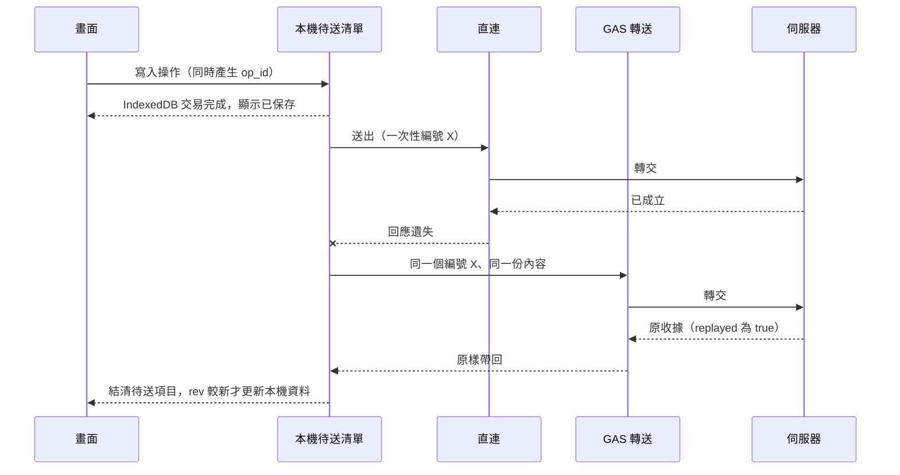
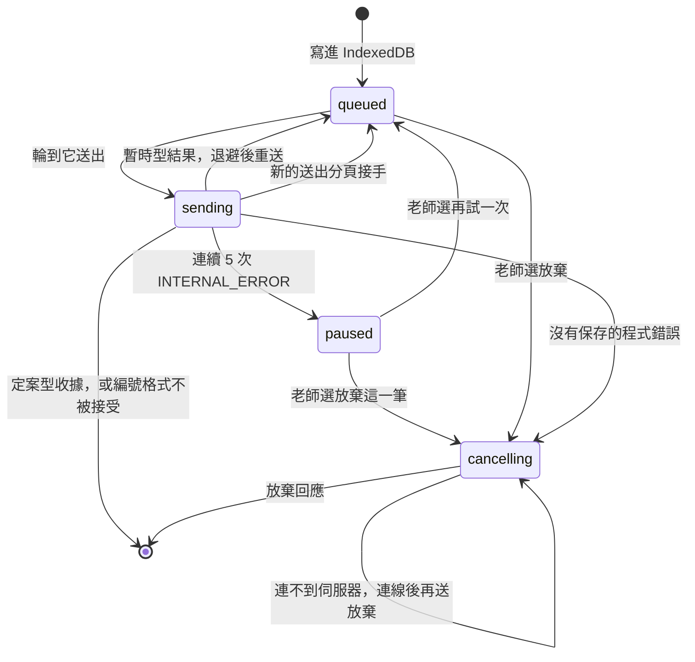

# 呼嚕嚕小鎮 改版操作規格（operation contract）v0.4（總則，第一到五節）

> 本規格分三份：`01-操作規格-v0.4-總則.md`（第一到五節）、`02-操作規格-v0.4-操作與點數.md`（第六到八節）、`03-操作規格-v0.4-連線讀取與未決.md`（第九到十七節）。節號全文共用，跨檔引用以節號為準。
> 本文件是「資料庫寫入程序」「資料庫角色與權限」「新版後端操作介面」「前端待送清單與 GAS 轉送」四張施工單共同的依據，也是下一輪轉換器施工題目的依據（7.4、7.5）。
> 規則寫到施工者不必猜為止。還需要人決定的事集中在 15.2，每題附建議與不回覆時的預設。
> 文中「規則」表示設計上的要求，還沒有在真的 PostgreSQL 或瀏覽器上驗證過。要驗證的規則集中在第十六節。
> 端點路徑、程序名稱、欄位名稱是暫定名稱，施工單可以調整拼法，但不能改語意。
> 本文件會放進公開的程式倉庫，所以不寫主機、網域、帳號與設定檔的細節。那些寫在各施工單。

## v0.4 主要變更

依主控 2026-11-15 20:25 裁定（畫面規劃 `05-v0.2-主控裁定.md` 第十二節）：平板只是瀏覽管道，和教室電子白板一樣，不做設備認證。老師登入後切到「學生點收模式」再交給學生。編號只退役、不重排。

1. 角色 L（小組長）標已移除，代號保留。2.1 角色表後寫明學生點收模式是畫面限制，不是權限邊界，伺服器只看到老師的權杖（2.1）。
2. 入口只剩老師、小野、排程、系統：一、2.2（第 1、2 步與鎖內重驗的說明）、2.3（拿掉配對編號）、2.5、2.6 第 1 點、3.1、3.4、4.5 刪掉小組長與配對的字樣。2.2 的鎖內重驗保留（v0.3 審查黑喵 F7 的一般做法，不只為了配對），16.1 改用「小野授權在排隊時被拿掉」驗證；4.5 查詢讀同一時間點的要求只為了收回配對，拿掉（主控 20:43 裁定）。
3. 2.6 第 4 點的小組長範圍標已移除，小野的範圍不變。
4. 第五節：E-13 `PAIRING_INVALID` 標已移除，號碼保留。E-02、E-04 刪掉配對的說明。E-20、E-21 保留，只刪小組長字樣。E-24 拿掉 `only_if_group_not_in_use` 那一種情況。一第 6 點補上退役後實際使用的操作與錯誤碼數量，第 7 點註明 Q10、Q13 與 N6 已被取代。
5. 第一輪審查修正（2026-11-15，主控裁定 12.9）：4.6 表後補「需要處理」怎麼結案，「知道了」只在本機移除、不產生操作；2.2 登出那一句加上指向 11.1 的本機資料處理。
6. 第二輪複核修正（2026-11-15，主控裁定 12.11、12.12）：4.6 表後加一段例外，放棄回 `CLASS_FORBIDDEN` 後移進「需要處理」的項目不能按「知道了」，只能再試放棄，或進那個班用清除此班級本地資料整班丟掉；再試放棄拿到原收據時照收據的結果處置。
7. 定稿後修正（2026-11-23，主控裁定，對照後端實作）修正 4.1、4.2、4.4、4.5 的停批、成員收據、版本串接、同步序號與查詢。第五節更新停批條件並補兩個請求層級錯誤碼，第一節同步更新數量。

## v0.3 主要變更

1. 撤銷改用可傳遞的基準 `basis_rev`，取代 v0.2 單層的 `restores_rev`。撤銷以外的改動產生新的基準，撤銷把基準退回原操作之前。收據的 `changes` 另記修改前的基準與修改前的值（2.5，第八節）。
2. 撤銷「從無到有建立的繳交」時，保留這一列但標成不參與（`assignment_active` 為 false），不參與每日任務、統計與小野的檢視。版本條件 `{"rev": 0}` 可以落在這種列上（2.5）。
3. 撤銷遇到老師事後單獨沖回或改過金額的扣分，照撤：已經沒有有效效果的跳過，改過金額的照現在的金額沖回，收據帶提示提醒老師，不擋（專案負責人 2026-11-15 裁定，15.3）。
4. 取得班級鎖之後、登記一次性編號之前，在鎖內再驗一次身分與班級存取權。放棄也一樣。查詢在同一個資料庫交易內驗身分與讀收據（2.2、3.4、4.5）。
5. 新的送出分頁接手時，把前一個分頁留下的「送出中」改回「待送」，同編號重送（4.4、4.6）。錯誤碼數量不變，E-02、E-09、E-26、E-35、E-36、E-37 的意思有補充，新增一個提示碼（第五節）。

v0.2 的變更紀錄在歸檔的 v0.2 檔頭。

## 一、結論與範圍

1. 改版後所有會改資料的動作都是「一筆操作」。老師經網站後端送出，小野與排程直接呼叫資料庫程序，兩邊進同一支寫入程序，套同一套規則。
2. 每筆操作帶一個由送出端產生的一次性編號。伺服器永久保存編號與結果：同編號同內容重送，回原結果。同編號不同內容，拒絕且不動原操作。
3. 新舊狀態的判定不看裝置時間，只看「這筆操作是根據哪一版資料做的」。版本對不上就拒絕，交給老師處理，不自動覆蓋。
4. 加扣分的「同一效果只發生一次」由資料庫的效果紀錄與唯一限制保證，不靠一次性編號。老師與小野各送一次，只會扣一次。
5. 點數交易只增不改。更正與沖回都跟著「根交易」計算是否計入累計與期間統計，不看理由文字。
6. 本版涵蓋 53 種操作、47 個錯誤碼、4 個提示碼。其中 OP-48、OP-49 與 E-13 已移除（2026-11-15，學生點收模式），號碼保留不重排，實際使用的是 51 種操作、46 個錯誤碼。聯絡簿、課表、行事曆（第 4 階段）的操作不在本版，只保留命名空間。
7. v0.1 的 15 個未決問題已全部定案（15.1），其中 Q10 與 Q13 的配對碼那一件已由學生點收模式取代（2026-11-15）。v0.2 新列的 6 題（15.2）有 3 題已定案，N6 已由學生點收模式取代、不必再決定，另 2 題（N1、N2）沒有回覆，照建議施工。撤銷的寬嚴由專案負責人定案（15.3）。
8. 上線有一個硬性前提（2.1）：網站後端、小野、瓦力三個程序的系統帳號與設定檔權限隔離完成之前，寫入程序不得上線。
9. 舊版已經扣過的分，不會因為換成新版就被當成沒扣過。轉換器只在候選唯一時列出候選，正式匯入前由主控逐筆接受或否決，接受的才把繳交連到舊扣分交易。其餘標成未裁決，由老師在需要時決定（6.13、7.5）。
10. 撤銷只回復「還停在原操作之後」的資料。後來被別人改過、或回復之後會違反限制的，整筆回衝突、什麼都不改，交給老師處理（第八節）。

不在本版範圍：資料庫帳號與權限表的實際設定（1B 權限工單）、舊資料匯入路徑（1A 轉換器加專用匯入程序，不經本規格的操作，不觸發任何獎懲）、正式切換程序（1D）、畫面設計。

## 二、名詞與共通規則

### 2.1 角色

| 代號 | 角色 | 怎麼進來 | 身分怎麼認定 |
|---|---|---|---|
| T | 老師 | 網站後端（直連或經 GAS 轉送） | 登入權杖對應的老師帳號，且必須是該班擁有者 |
| L | 小組長：已移除（2026-11-15，學生點收模式） | 不適用 | 不適用。平板只是瀏覽管道，用老師的登入切到學生點收模式，伺服器不另設角色 |
| A | 小野（班務助理 AI） | 直接連資料庫，只能呼叫固定程序 | 資料庫連線帳號。操作者欄位由資料庫依連線帳號填，呼叫端傳入的操作者一律忽略 |
| S | 排程 | 網站後端的定時工作 | 後端以排程身分呼叫。操作者記為 `scheduler` |
| W | 瓦力（評語產生服務） | 不直接寫入 | 由網站後端呼叫，結果由後端以系統身分寫入（操作 OP-47） |

**學生點收模式是畫面限制，不是權限邊界**（主控裁定第十二節第 1 條）。老師在平板、電子白板或教室電腦登入後，可以切到學生點收模式交給學生點收。這時用的仍是老師的登入，本機存的是整班資料，和教室電腦相同，伺服器只看到老師的權杖。學生點收模式畫面上不顯示的資料（例如點數、餘額），只是畫面不顯示，不是伺服器保證。學生在這個模式記的點收用 OP-15 送出，先成待確認（6.3）。殘餘（接受）：會操作瀏覽器的人拿得到老師權限與整班資料。

網站後端共用一個資料庫帳號，所以老師、排程、系統三種身分是後端驗證權杖後傳給寫入程序的。寫入程序只在連線帳號是網站帳號時才相信這個參數。連線帳號是小野時，操作者固定是小野。

**上線前提（硬性）。** 網站後端、小野、瓦力三個程序在主機上必須各用各的作業系統帳號執行，網站的資料庫連線設定只有網站程序自己讀得到。這件事完成、並照第十六節的驗證通過之前，`submit_operation` 與 `agent_submit` 不得建立在正式資料庫上，新版的寫入入口也不得開放。理由：寫入程序相信網站帳號傳進來的操作者。別的程序只要拿得到網站的資料庫連線資訊，就能冒用任何一位老師的身分送操作，小野的角色限制與上限全部失效。資料庫這一層要配合兩件事：`submit_operation` 只授權給網站的資料庫帳號執行。小野的資料庫帳號只能執行 `agent_submit` 與查詢 11.3 的檢視表。實際的帳號與權限設定寫在「資料庫角色與權限」施工單，不寫在本規格。

### 2.2 兩個入口、一支程序

- 網站入口：`POST /api/v2/ops`，一個請求可帶 1 到 50 筆操作，逐筆回收據（第四節）。
- 資料庫入口：小野呼叫 `agent_submit(class_id, call_id, ops, note)`（6.11），排程呼叫 `submit_operation(op, actor)`。
- 兩個入口最後都呼叫同一支 `submit_operation`。它對每筆操作做的事依序固定：
  1. 驗班級存取權，這一步不上鎖。操作者必須是這個班的擁有者（老師），或被授權這個班的小野與排程。班級不存在和沒有存取權回同一個結果 `CLASS_FORBIDDEN`，回應內容相同，伺服器不留任何東西。建班（OP-01）的做法與例外見 2.6 第 3 點。
  2. 開始資料庫交易，鎖住該班級列（同一班的操作排隊執行，一次一筆）。建班時班級列還不存在，改由班級編號的主鍵擋重複。**取得鎖之後、做第 3 步之前，在鎖內再驗一次第 1 步的條件**：老師仍是這個班的擁有者。小野與排程仍被授權這個班。不通過就回復交易，不登記編號、不留任何東西，回 `CLASS_FORBIDDEN`，伺服器不保存。一個請求帶多筆時（4.1 每筆各自一個交易），這是那一筆的暫時型結果：前面已成立的照回收據，這一筆回 `retry` 加這個碼，後面的回 `retry` 加 `NOT_PROCESSED`。
  3. 登記一次性編號。已存在就走重送規則（3.3），不再往下。
  4. 檢查角色能不能呼叫這種操作、目標是否在權限範圍內（順序見 2.6）。
  5. 檢查輸入格式與版本條件（2.5）。
  6. 套用狀態變更、效果判定、點數交易，寫入操作紀錄，班級序號加一。
  7. 把收據存進操作紀錄並提交。
- 第 2 步的鎖內重驗在 v0.3 是為了讓收回配對立即生效。配對已移除（2026-11-15，學生點收模式），重驗照第 2 步保留。老師登出不是班級操作，不在這條規則內：登出前已經通過第 1 步的請求仍會成立。登出時這台裝置上的班級資料怎麼處理，見 11.1。
- 第 2 到 7 步在同一個資料庫交易內，班級鎖從第 2 步持有到提交或回復為止。不得先用另一個交易鎖班級、放掉、再執行後面的步驟。那樣兩個連線仍然可能同時讀到最後一件商品。
- 第 4 到 6 步任何一步判定拒絕，就回復這筆操作造成的所有變更，只留下「這個編號被拒絕、錯誤碼是什麼」這一列。
- 一次呼叫裡要執行多筆內部操作的情況有三種：老師確認小野的暫緩批次（OP-16）、整批撤銷（OP-51）、小野的 `agent_submit`。這時由外層持有交易與班級鎖，內部每筆操作用儲存點隔開，不得自行提交。內部操作被拒絕時回復到它自己的儲存點並記下結果，外層最後一次提交。鎖內重驗在外層拿到鎖時做一次，涵蓋整次呼叫。
- 網站後端在呼叫資料庫之前也要先做第 1 步的檢查，沒有存取權的請求不進資料庫。後端這一步只在一種情況讓班級不存在的請求進資料庫：本請求第一筆是建班，建班內容的班級編號等於請求的 `class_id`，而且這個編號符合 2.3 的第 4 版格式。格式判斷和寫入程序檢查建班編號的方式逐字相同。其他請求一律只看擁有權，包括班級編號是 64 字元舊編號的建班。資料庫程序裡的第 1 步與第 2 步的重驗仍然要做，不因為後端做過就省略。
- 規則（待驗證）：每筆操作先鎖班級列。這讓同班的操作有唯一的先後順序，班級序號的順序就是提交順序，也讓「兩台裝置同時買最後一件商品」這類情況不需要另外設計鎖定順序。兩個班、一位老師加一個助理的流量下，排隊的等待時間可以忽略。

### 2.3 編號由送出端產生

操作在離線時就要能互相引用（例如離線建立作業後馬上點收），所以新資料的編號由送出端產生：

- 一次性編號 `op_id`、作業 `task_id`、背包物品 `item_id`、訂正項目 `correction_id`、商品 `product_id`、職務 `job_id`、規則 `rule_id`、公告 `announcement_id`、學生 `student_id`、班級 `class_id` 都是送出端產生的第 4 版 UUID（小寫、含連字號、36 字元）。
- 繳交紀錄不另外給編號，用（`task_id`, `student_id`）這一對指定。
- 實體編號的唯一性以班級為範圍：資料表用「班級編號加實體編號」當鍵。同一班裡送來的實體編號已存在而且不是同一筆操作建立的，回 `ID_CONFLICT`。別班用了同一個編號互不影響，也不會因此回 `ID_CONFLICT`，所以沒有人能用這個錯誤碼探測別班有哪些編號。
- 舊資料轉換進來的列沿用 1A 轉換器產生的穩定編號（SHA-256 字串，64 個十六進位字元）。所以實體編號欄位的型別是文字，不能宣告成 UUID 型別。送出端新建的編號只收 36 字元的 UUID，不可能和 64 字元的舊編號相同。舊編號不能經建班建立，所以後端不對它放行建班（2.2 第 1 步、2.6 第 3 點）。

### 2.4 時間

- 伺服器時間（提交時間 `committed_at`）是唯一用來排序與統計的時間，存成含時區的時間戳。
- 所有「日期」（截止日、期間統計的起訖、每日任務的日期、逾期判定）一律用 Asia/Taipei 的日期。
- 送出端的時間 `client_time` 只用來顯示「老師當時是幾點按的」，任何規則都不拿它判斷先後。

### 2.5 版本條件 `expect` 與基準 `basis_rev`

會被改寫的列都有兩個欄位：`rev`（整數，每次改動加一，新建時是 1，永遠不倒退）、`last_op_id`（最後改動它的操作編號，只供顯示與追查）。

**基準。** 繳交與訂正這兩種列可以被撤銷回復，另有一個欄位 `basis_rev`（整數，不可空），意思是「這一列目前的內容，是第幾版成立當下的內容」。規則只有三條：

1. 新建時等於 1。舊資料匯入時也是 1（7.4 I）。
2. 撤銷以外的任何改動，`rev` 加一，`basis_rev` 等於新的 `rev`。一般操作、排程（OP-52 記逾期日期）、下面的連帶推進都算。改回和以前相同的值也一樣產生新的基準，不能靠內容相同越過別人的修改。
3. 撤銷回復這一列時，`rev` 照常加一，`basis_rev` 設成原操作收據記下的修改前基準（`prev_basis_rev`）。

所以 `rev` 只往前走，`basis_rev` 可以退回。撤銷的前提是「這一列現在的 `basis_rev` 等於原操作對它的成立後版本」（8.1）。送出端的版本條件只比 `rev`，不比 `basis_rev`。

**不參與的繳交。** 繳交列另有 `assignment_active`（布林，不可空，新建與匯入時是 true）。false 表示「這位學生目前沒有這份作業的繳交」。只有撤銷「從無到有建立這筆繳交」的操作會把它設成 false（8.2），同時狀態設成 `pending`、`basis_rev` 設成 0。這種列：

- 不參與每日任務（6.5）、畫面上的統計與名單、小野的檢視表（11.3）。學生點收模式送的提議（OP-15）把它當成繳交紀錄不存在。
- 讀取端點照常帶回它與 `assignment_active`（11.1），讓送出端記得它的 `rev`，本機資料不倒退（4.4 第 10 點）。畫面把它顯示成「沒有這筆繳交」。
- 沒有有效的遲交、缺交效果（規則，待驗證，16.1）。6.4 的矩陣把它當成狀態 `pending`、沒有扣分。
- 可以用 OP-14 重新建立：帶 `{"rev": 0}` 或帶它的實際 `rev` 都通過（見下面的判定）。重新建立一律算改動：`assignment_active` 設回 true，`rev` 加一，`basis_rev` 等於新的 `rev`。不會因為狀態本來就是 `pending` 而變成不改資料。

**收據記什麼。** 每筆成立的操作，收據的 `changes` 列出它新建或改到的每一列有版本的資料（4.2），每一項記：

| 欄位 | 內容 |
|---|---|
| `prev_rev`、`rev` | 改之前與改之後的 `rev`。新建的列 `prev_rev` 是 0 |
| `prev_value`、`value` | 這筆操作改到的欄位，改之前與改之後的值。新建的列 `prev_value` 是 `null`。重新建立不參與的繳交時，`prev_value` 是 `{"status": "pending", "assignment_active": false}` |
| `prev_basis_rev`、`basis_rev` | 只有繳交與訂正有，改之前與改之後的基準。新建的列與重新建立不參與的繳交，`prev_basis_rev` 都是 0 |
| `last_op_id` | 就是這筆操作 |

改之後的 `rev` 下稱這筆操作對那一列的**成立後版本**。成立但不改資料的操作，`changes` 仍列出目標列與當時的 `rev`、`basis_rev`，值不變。效果紀錄與交易不是有版本的列，不列在 `changes`，記在 `result`（4.2、6.4）。

**連帶推進。** 有一種操作改的不是繳交本身，卻改變了這筆繳交所帶扣分的歸屬：OP-53 裁決歷史效果（6.13）。它在同一個交易內把那筆繳交的 `rev` 加一、`basis_rev` 設成新的 `rev`，這筆繳交列在 OP-53 的 `changes`。`link` 與 `none` 兩種答案都推進。OP-26 更正金額、OP-27 單獨沖回、OP-12 作廢時的沖回只改交易與效果，**不推進**繳交的版本與基準：老師事後改過的扣分，撤銷時照撤（8.1，專案負責人 2026-11-15 裁定，15.3）。

**版本條件。** 「把某一列設成某個值」的操作（下稱設定型操作）必須帶 `expect`。`rev` 與 `after_op` 兩種寫法擇一，`rev` 為 0 是新建時的特例：

| 寫法 | 意思 | 什麼時候用 |
|---|---|---|
| `{"rev": 4}` | 我看到的是第 4 版 | 根據伺服器已確認的資料操作 |
| `{"after_op": "<op_id>"}` | 我是接在這筆操作之後做的 | 同一台裝置連續改同一列，前一筆還沒拿到收據 |
| `{"rev": 0}` | 我認為這一列還不存在 | 新建，或替舊資料、後來加入的學生補第一筆繳交紀錄 |

伺服器的判定：

- `expect.rev` 不是 0：直接和目標列現在的 `rev` 比，相等才通過。
- `expect.rev` 是 0：目標列不存在，或目標是 `assignment_active` 為 false 的繳交列，才通過。離線裝置不知道這一列曾經建立又被撤銷，送 0 照樣能重新建立，效果等同第一次建立。施工時不能寫成「列不存在才通過」。
- `expect.after_op`：先換成那筆操作的成立後版本，再和目標列現在的 `rev` 比，相等才通過。那筆操作不存在、被拒絕、被放棄，或它的 `changes` 裡沒有這一列，一律算不符。

不通過回 `STALE_STATE`，收據的 `current` 帶目前的值、`rev`、最後改動者與時間。

- 設定型操作沒帶 `expect` 回 `INVALID_PAYLOAD`。沒有「強制覆蓋」的寫法。唯一的例外是 OP-08，它的版本條件寫在每個項目裡（6.2）。
- 累加型操作（手動加扣分、套用規則、購買、發薪）不帶 `expect`，各自的防重複方式寫在操作清單。
- 新值和目前值相同、而且版本條件通過時，操作成立但不改任何資料，`rev` 與 `basis_rev` 都不變，收據的 `result.noop` 是 `true`。重新建立不參與的繳交不適用這一條（見上）。

### 2.6 班級範圍與檢查順序

1. **所有目標都在本班範圍內查找。** 操作碰到的每一種實體（學生、作業、繳交、訂正、交易、背包物品、商品、職務、規則、公告、待確認項目、原操作、批次、效果紀錄）一律用「本請求的 `class_id` 加實體編號」查找。查不到一律回 `NOT_FOUND`，不區分「不存在」與「屬於別班」。只帶單一編號的操作（OP-16、OP-17、OP-19 到 OP-23、OP-26、OP-27、OP-32、OP-50、OP-51、OP-53）尤其不得只用實體編號查。
2. **建班的來源班級要驗擁有者。** OP-01 帶 `inherit_from_class_id` 時，呼叫者必須也是來源班級的擁有者。不是擁有者和來源班級不存在回同一個結果 `CLASS_FORBIDDEN`，不複製任何東西。
3. **建班時班級編號已存在。** 擁有者是呼叫者：照重送規則處理，不是同一筆操作就回 `ID_CONFLICT`。擁有者不是呼叫者：回 `CLASS_FORBIDDEN`。
   - 班級編號不是第 4 版格式時（例如 64 字元舊編號），建班不放行班級不存在的情況：不存在與不屬於呼叫者回同一個請求層級的 `CLASS_FORBIDDEN`，回應內容相同，伺服器不留任何東西。
   - 接受的殘餘：班級編號是第 4 版格式時，建班分得出這個編號有沒有被別人用掉。沒被用掉時這一筆進資料庫，可能建成、被拒絕，或回 `INVALID_OP_ID`；被別人用掉時回請求層級的 `CLASS_FORBIDDEN`。這是本點規則本身的結果，關不掉。接受的理由：這種編號由送出端隨機產生，要先從別處拿到編號才能問；班級不刪除只封存，所以問得到的只有離線建的班送到了沒。
4. **小野先驗範圍。** 第 4 步一開始就檢查目標是否在範圍內。不在範圍內，或編號根本不存在，一律回 `SCOPE_FORBIDDEN`。在這之前不得回 `NOT_FOUND`、`ENTITY_INACTIVE`、`INVALID_TRANSITION`、`STALE_STATE`。小組長的範圍：已移除（2026-11-15，學生點收模式），學生點收模式用老師的登入，伺服器沒有小組這一層範圍。小野的範圍：目標屬於本班，撤銷的對象是它自己的操作。
5. **範圍內才往下檢查。** 順序固定為 `NOT_FOUND`、`ENTITY_INACTIVE`、`INVALID_TRANSITION`、`STALE_STATE`，然後是各操作的專屬檢查。老師沒有範圍限制，從這一點開始。
6. **範圍外的回應不帶資料。** `CLASS_FORBIDDEN`、`SCOPE_FORBIDDEN`、`NOT_FOUND`、`OP_ID_REUSED` 的回應不帶 `current`，也不帶任何實體的內容。

## 三、一次性編號

### 3.1 誰產生、格式

| 送出端 | 產生方式 |
|---|---|
| 瀏覽器（老師） | `crypto.randomUUID()`（第 4 版），在操作寫進本機待送清單的同一個 IndexedDB 交易內產生並保存，之後不再變 |
| 小野 | 交接手冊提供的工具在送出前產生第 4 版 UUID。`agent_submit` 收到沒有編號的操作回 `INVALID_OP_ID` |
| 排程、系統 | 由固定內容算出的第 5 版 UUID。排程用（班級、工作名稱、日期），同一天重跑會得到同一個編號。系統代瓦力寫入用原請求的編號（OP-47） |

- 格式不符（不是 36 字元小寫 UUID）回 `INVALID_OP_ID`，這筆不保存。
- 第 5 版編號只有排程與系統身分能用。整批撤銷（OP-51）內部每一筆撤銷的編號也是伺服器算出的第 5 版編號（8.4），屬於系統產生，操作者記送出 OP-51 的老師，但這些編號不經任何對外入口。對外入口（`/api/v2/ops`、`/api/v2/ops/cancel`、`agent_submit`）收到不是第 4 版的編號一律回 `INVALID_OP_ID`。理由：排程的編號算得出來。如果任何有本班權杖的人都能先用那個編號送一筆或放棄它，當天的逾期排程就永遠不會成立。

### 3.2 保存多久

永久保存。一次性編號就是操作紀錄的主鍵，操作紀錄不清除，所以不存在「編號過期後重送變成新操作」的情況。伺服器不因為操作太舊而拒收（15.1 Q5）。舊操作會不會成立，只由版本條件決定。

### 3.3 重送

伺服器對收到的每筆操作算一個內容雜湊：把 `type`、`class_id`、`payload`、`expect` 四個欄位做固定序列化（物件的鍵遞迴排序、陣列順序不變、不加空白）後取 SHA-256。`client_time`、`client_seq`、`batch_id`、走哪一條路都不算進去。

| 情況 | 伺服器怎麼做 | 回什麼 |
|---|---|---|
| 編號不存在 | 照 2.2 執行 | 新收據 |
| 編號存在，雜湊、操作者、班級都相同 | 不重新執行 | 原收據，`replayed` 設為 `true` |
| 編號存在，雜湊、操作者、班級有任何一項不同 | 不執行、不改原操作、不保存這次的內容 | `OP_ID_REUSED`，不帶原操作的任何內容 |
| 編號存在、狀態是 `cancelled`（放棄時沒有內容可比，只比操作者與班級），兩者都相同 | 不執行 | `OP_CANCELLED` |
| 兩個相同編號同時到 | 規則（待驗證）：班級鎖加主鍵讓後到的等前一筆提交，再走上面第二列 | 原收據 |

「原收據」是當時存下來的那一份，不重新計算。原操作成立之後資料又被別人改過，重送拿到的仍是當時的結果，所以送出端不得拿它覆蓋較新的本機資料（4.4 第 10 點）。要看最新資料，用讀取（第十一節）。能走到這一步的呼叫者都已通過班級存取權檢查。第 4 版編號是隨機的，外人猜不到別人的編號，所以 `OP_ID_REUSED` 實際上只會出現在程式錯誤。

### 3.4 放棄一筆還沒成立的操作

老師在待送清單選「放棄」時，送出端不能只刪本機那一筆，因為先前送出的請求可能還在路上。做法是呼叫 `POST /api/v2/ops/cancel`，內容 `{ "class_id": "…", "op_id": "…" }`。

伺服器先驗班級存取權，再開交易鎖班級列，拿到鎖之後照 2.2 第 2 步在鎖內再驗一次（不通過就不登記任何東西）。放棄和提交用的是同一把鎖，所以「放棄先到還是提交先到」一定有唯一的答案，不會兩邊都成功。

| 情況 | 伺服器怎麼做 | 回什麼 |
|---|---|---|
| 編號不存在 | 登記這個編號為 `cancelled`，記下班級與操作者。之後同編號再到一律回 `OP_CANCELLED`，永遠不會成立 | `cancelled` |
| 編號已存在，班級與操作者都和呼叫者相同 | 不改任何東西 | 原收據（可能已經成立） |
| 編號已存在，但班級或操作者不同 | 不改任何東西 | `OP_ID_REUSED`，不帶任何內容 |
| 班級不存在，或呼叫者對這個班沒有存取權（例如離線建的班，建班那一筆被拒絕） | 不登記任何東西 | `CLASS_FORBIDDEN`（請求層級，不保存） |

- 已成立的操作不能放棄，只能撤銷（第八節）。
- 老師只能放棄自己的編號。上表的第三列已經涵蓋。
- 送出端拿到放棄回應之後，才可以從待送清單移除（4.6）。

## 四、提交收據與待送清單

### 4.1 請求

```json
{
  "v": 1,
  "class_id": "…",
  "batch_id": null,
  "ops": [
    {
      "op_id": "0b6f1c1e-…",
      "type": "submission.set_status",
      "payload": { "task_id": "…", "student_id": "…", "status": "missing" },
      "expect": { "rev": 3 },
      "client_time": "2026-11-20T08:05:11+08:00",
      "client_seq": 17
    }
  ]
}
```

- `batch_id` 由送出端選填，只用來在操作紀錄把同一次按鈕產生的多筆操作歸成一組，不影響執行。小野的 `batch_id` 就是它那次呼叫的 `call_id`（6.11）。
- 直連時登入權杖放 `Authorization` 標頭。經 GAS 時放在轉送包裝的內容裡（第十節）。兩條路的這一段內容完全相同。
- 伺服器依陣列順序一筆一筆處理，每筆各自一個資料庫交易。前一筆被拒絕不影響後一筆，除非後一筆的 `expect.after_op` 指向它（那會自然得到 `STALE_STATE`）。小野的 `agent_submit` 不同，整次呼叫是一個交易（6.11）。
- 網站提交時，某一筆回 `retry` 且錯誤碼為 `CLASS_FORBIDDEN`、`SERVER_BUSY`、`INTERNAL_ERROR` 之一，伺服器停止處理同一請求裡排在它後面的操作，後續各筆回 `retry` 加 `NOT_PROCESSED`。單筆 `BAD_ENVELOPE`、`INVALID_OP_ID`、`OP_ID_REUSED` 不停批，後續操作照常處理。 `server/v2/ops/submit.js:7-11,40-51`、`server/db-v2/sql/050-access.sql:133-145`、`server/db-v2/sql/080-operation-records.sql:50-65`、`server/db-v2/sql/090-submit.sql:269-282`
- 上限：一個請求最多 50 筆、內容最多 512 KB。單筆操作的 `payload` 最多 64 KB。超過回 `BAD_ENVELOPE`。

### 4.2 回應與收據

```json
{
  "server_time": "2026-11-20T00:05:12Z",
  "class_seq": 1201,
  "receipts": [
    {
      "op_id": "0b6f1c1e-…",
      "status": "committed",
      "code": "OK",
      "replayed": false,
      "class_seq": 1201,
      "committed_at": "2026-11-20T00:05:12Z",
      "result": { "noop": false, "transactions": ["…"], "effects_added": [], "effects_reversed": [] },
      "changes": [
        { "entity": "submission", "key": { "task_id": "…", "student_id": "…" },
          "prev_rev": 3, "rev": 4, "prev_basis_rev": 3, "basis_rev": 4, "last_op_id": "0b6f1c1e-…",
          "prev_value": { "status": "pending" }, "value": { "status": "missing" } }
      ],
      "warnings": []
    }
  ]
}
```

| `status` | 意思 | 伺服器有沒有保存 | 送出端能不能移除 |
|---|---|---|---|
| `committed` | 已成立 | 有 | 可以 |
| `held` | 已收下，等老師確認才執行（只會發生在小野） | 有 | 可以（之後用確認項目追蹤） |
| `rejected` | 已定案拒絕，同編號重送還是這個結果 | 有 | 可以，但要移到「需要處理」清單，不能無聲丟掉 |
| `cancelled` | 這個編號已被放棄 | 有 | 可以 |
| `retry` | 這次沒處理成，伺服器沒有留下任何東西 | 沒有 | 不可以，留在待送清單用同編號重送 |

- `changes` 列出這筆操作改到的每一列，帶新舊版本、新舊基準（只有繳交與訂正）及新舊值（2.5）。送出端依 4.4 第 10 點套用新值。撤銷用修改前的基準與值。整批撤銷（OP-51）與小野暫緩批次的確認（OP-16）是例外。成員的異動、交易與效果歸各成員操作，外層收據不帶這些資料。整批撤銷的外層 `changes` 為空，暫緩批次確認只帶待確認項目列。學生提議的確認照一般規則帶繳交異動與確認列。 `server/db-v2/sql/040-receipts.sql:11-24`、`server/db-v2/sql/350-batch-undo.sql:145-162`、`server/db-v2/sql/245-agent-held-confirmation.sql:65-74,92-103`、`server/db-v2/sql/250-confirmation-operations.sql:64-79`
- `result.effects_added` 與 `result.effects_reversed` 記這筆操作新增與沖回了哪些效果、新增時的金額，以及沖回當時的金額快照（6.4）。撤銷靠這兩份清單。撤銷自己的收據另有 `result.undo`（8.1）。
- `held` 的收據在 `result.confirmation_id` 帶待確認項目的編號。
- `class_seq` 是該班的操作序號，只有 `committed` 會拿到。讀取用它判斷本機資料落後多少（第十一節）。
- 整個請求層級的失敗（沒登入、被限流、格式錯）不回 `receipts`，用 HTTP 狀態碼加 `{ "error": { "code": "…", "retry_after": 30 } }`。這種情況所有操作都留在待送清單。

### 4.3 定案型與暫時型

- **定案型**：伺服器已經對這個編號下了結論並保存。包含成立、等待確認、放棄，以及所有「內容本身不成立」的拒絕（格式錯、越權、版本過期、餘額不足等）。同編號重送只會拿到同一個結果。
- **暫時型**：伺服器沒有對這個編號留下任何東西。包含沒登入或權杖過期、限流、資料庫忙、後端連不到、未預期的伺服器錯誤。處置一律是「排除原因後用同一個編號重送」。「查不到這個編號」不等於失敗，也是暫時型，處置相同。

### 4.4 待送清單的規則（1C 施工依據）

1. 一筆操作要等「寫進 IndexedDB 的交易完成」才算本機保存成功，畫面才能顯示已保存。寫入失敗要顯示失敗，不得套用到畫面。
2. 待送清單的每一筆綁定建立它的帳號與班級。只有目前登入的是同一個帳號時才送。不是的話留著，提示「有 N 筆是另一個帳號留下的」，不得用別的帳號代送。負責送出的分頁每次送出前重新讀取目前登入的帳號，帳號換了就立刻停止送出原帳號的項目。
3. 排序號 `client_seq` 在 IndexedDB 裡共同分配：每個（帳號、班級）有一個計數器。建立操作時，在同一個 IndexedDB 交易內讀計數器、加一、寫回、寫入這筆操作。分頁不得在自己的記憶體裡數，否則兩個分頁會拿到同一個序號。
4. 同一班的操作嚴格照 `client_seq` 先後送。最前面那一筆還沒離開待送清單，後面的不送，也不得自動跳過它。
5. 同一個瀏覽器同一時間只有一個分頁負責送出（規則，待驗證：用 Web Locks 選出一個）。其他分頁只寫待送清單。就算兩個分頁都送了同一筆，伺服器也只執行一次。**取得送出權的分頁（含重新整理後的同一個分頁）開始送之前，先把清單裡所有「送出中」改回「待送」，編號與排序號不變，然後照第 4 點的順序同編號重送。「放棄中」的照舊續送放棄。** 理由：只有持有送出權的分頁會把項目改成送出中。新的分頁拿得到送出權，表示前一個持有者已經不在（關閉、當掉、重新整理），它留下的送出中結果不明，同編號重送是安全的（3.3）。不接手的話，最前面那一筆永遠停在送出中，同班後面的項目全部送不出去。
6. `expect.after_op` 要引用的前一筆，一律從 IndexedDB 的待送清單找（同一列最後一筆還沒結清的操作），不看分頁自己記得的內容。所以前一筆是別的分頁建立的也接得上。沒有前一筆時，目標是本機知道的列（含不參與的繳交，2.5）就帶它已確認的 `rev`，本機沒有這一列才帶 `{"rev": 0}`。 整批撤銷與小野暫緩批次確認的外層 `op_id` 不得接成員改到的列。前端不預估這些成員列的結果，找同一列最後一筆還沒結清的操作時也不計入這兩種外層操作。暫緩批次確認的外層 `changes` 所帶的待確認項目列仍可按一般規則串接。 `server/db-v2/sql/150-version-conditions.sql:24-55`、`server/db-v2/sql/350-batch-undo.sql:145-162`、`server/db-v2/sql/245-agent-held-confirmation.sql:92-103`
7. 畫面顯示的資料是「伺服器已確認的資料」加上「待送清單依序套用後的預估結果」。待送中的項目要有看得出來的標記。被拒絕就拿掉預估結果並放進「需要處理」清單。購買與使用道具不適用預估結果（第 11 點）。
8. 從待送清單移出的唯一條件寫在 4.6：拿到足以確定這個編號不會再以別的結果成立的伺服器回應。每一種結果怎麼處置看 4.6 的表。本節其他地方與錯誤碼表的說法都以那張表為準。
9. 回應遺失（逾時、連線中斷、GAS 回傳不完整）時不產生新編號。標準做法是同編號重送。只想知道結果、不想讓它現在成立時，用查詢（4.5）或放棄（3.4）。
10. **本機已確認的資料不倒退。** 本機替每一列記下已確認的 `rev`。收據的 `changes` 或讀取帶來的某一列，只有 `rev` 大於本機已確認的 `rev` 時才覆蓋。相等或較小的只用來結清待送項目，不改本機資料。每班記兩個數字。**看過的最大序號**只用來判斷有沒有落後。**已套用到的序號**是 `read/changes` 的起點，只在兩種情況前進。整班或增量讀取的班級資料套用完成後，推到該回應的班級序號。收到 `committed` 收據且其 `class_seq` 剛好比已套用到的序號大一時，套用 `changes` 後推進一。收據序號比已套用到的序號加一還大時，依版本規則套用 `changes`，保留已套用到的序號，立即以原起點拉一次變更。序號不是數字的收據不參與序號判斷。覆蓋或結清之後，把還在待送清單裡的操作依序重新套用成預估結果。重送拿回的原收據（`replayed` 為 `true`）最容易是舊的，一定要過這一關。 `server/db-v2/sql/040-receipts.sql:3-9,27-49`、`server/db-v2/sql/090-submit.sql:197-204,224-236`、`server/v2/read/state.js:6-26`、`server/v2/read/changes.js:6-20`
11. **購買與使用道具要等收據。** OP-31 與 OP-32 只在最近一次連線檢查成功時才允許建立（15.1 Q6），而且不套用預估結果。送出後畫面顯示「處理中」，收到 `committed` 才顯示完成，老師這時才把東西交給學生。本機保存成功、連線檢查成功、預估結果都不能當成完成的依據。回應遺失時顯示「結果確認中」，用查詢或同編號重送問出結果，在那之前不得顯示成功或失敗。
12. 程式升版不得清掉待送清單。清單每一筆保存當時的 `v`。伺服器不認得的版本回 `BAD_ENVELOPE`，這時照 4.6 走放棄流程，不得直接移出。
13. 有項目待送超過 7 天時提醒老師（15.1 Q5）。伺服器不因為時間拒收。

### 4.5 查詢原操作

`POST /api/v2/ops/lookup`，內容 `{ "class_id": "…", "op_ids": ["…", "…"] }`（最多 50 個）。伺服器先驗班級存取權。查詢不改資料、不拿班級鎖。v0.3 要求驗身分與讀收據讀到同一個時間點（同一條查詢或 `REPEATABLE READ`），是為了不讓收回配對插在兩者之間；v0.4 沒有會在查詢途中改變呼叫者身分的操作，這項要求已移除（2026-11-15，學生點收模式，主控裁定）。

- 網站查詢只回呼叫的老師自己送出且留存在該班的操作收據。`held` 只會發生在小野的操作。小野用同一個 `call_id` 重送相同操作清單取得處理後的最新收據（規格 02 的 6.11），不經網站查詢。 `server/v2/ops/lookup.js:9-31`、`server/db-v2/sql/190-agent-submit.sql:74-96`、`server/db-v2/sql/188-agent-call-records.sql:50-64`、`server/db-v2/sql/245-agent-held-confirmation.sql:65-74`
- 其餘情況（沒有紀錄，或不是呼叫者的操作）：回 `{ "op_id": "…", "status": "unknown" }`。
- `unknown` 表示現在沒有紀錄，不保證之後不會出現（先前的請求可能還在路上）。要確定它永遠不會成立，用放棄（3.4）。



### 4.6 待送項目的狀態轉移

一個待送項目只有四種狀態：待送（`queued`）、送出中（`sending`）、暫停（`paused`）、放棄中（`cancelling`）。離開清單只有一條路：拿到伺服器的回應，而且這個回應足以確定這個編號之後不會再以別的結果成立。符合的只有三種：定案型收據、放棄回應、編號格式永遠不被接受（`INVALID_OP_ID`）。



| 收到什麼 | 這一筆怎麼辦 | 同班後面的項目 |
|---|---|---|
| `committed`、`held`、`cancelled` | 移出 | 繼續送 |
| `rejected`，處置是「請老師處理」 | 移出，放進「需要處理」並顯示原因 | 繼續送 |
| `rejected`，處置是「回報」（例如 `INVALID_PAYLOAD`） | 移出，放進「需要處理」並標成程式錯誤 | 繼續送 |
| 暫時型，處置是「重送」（含回應遺失） | 留在原位，退避後同編號重送 | 等這一筆 |
| `AUTH_REQUIRED`、`AUTH_EXPIRED`、`CLASS_FORBIDDEN`、`RELAY_FORBIDDEN` | 留在原位 | 等重新登入或補上設定 |
| `INTERNAL_ERROR` 連續 5 次 | 留在原位，狀態改成暫停。畫面顯示「同步暫停」與錯誤碼，老師選「再試一次」或「放棄這一筆」 | 等老師選 |
| 沒有保存的程式錯誤：`OP_ID_REUSED`、`ROUTE_NOT_ALLOWED`、拆成單筆後仍是 `BAD_ENVELOPE`（含不認得的 `v`） | 走放棄流程（3.4） | 等放棄回應 |
| `INVALID_OP_ID` | 移出，放進「需要處理」並標成程式錯誤。這個編號伺服器永遠不收，不必放棄 | 繼續送 |
| 老師對任何還沒結清的項目選「放棄」 | 走放棄流程 | 等放棄回應 |
| 放棄回應是 `cancelled` | 移出 | 繼續送 |
| 放棄回應是原收據 | 照那份收據的結果處置（它其實已經定案） | 繼續送 |
| 放棄回應是 `OP_ID_REUSED` | 移出，放進「需要處理」並標成程式錯誤。這個編號不可能再以這份內容成立 | 繼續送 |
| 放棄時連不到伺服器 | 留在原位，狀態是放棄中，連線後再送放棄 | 等這一筆 |
| 放棄回應是 `CLASS_FORBIDDEN`，重新登入後仍是 | 留在原位，畫面顯示「這個班在伺服器上不存在或不屬於目前帳號」。只有老師明確選「移到需要處理」才移出，內容完整保留在「需要處理」，不刪。這是本節「只有伺服器回應能讓項目離開」的唯一例外，因為這種回應不保證之後不會成立（例如建班那一筆還在另一台裝置的待送清單裡） | 老師選了才繼續送 |
| 新的送出分頁取得送出權時，清單裡有前一個分頁留下的「送出中」（4.4 第 5 點） | 改回待送，編號與排序號不變，照順序同編號重送。購買與使用道具在畫面上仍顯示「結果確認中」，直到收據回來 | 照順序等這一筆 |

**「需要處理」怎麼結案**（主控裁定 12.9 第 4 點，2026-11-15 第一輪審查 F4）：上表只規定項目怎麼離開待送清單。「需要處理」是這台裝置上的清單，項目放進去之後，只在老師按了處置才離開。「知道了」只移除這筆紀錄，不產生、也不送任何操作。「仍要改」這類處置才產生新的操作，照一般規則排進待送清單（9.1 第 4 步）。同一種原因的多筆可以一次全部「知道了」。被拒絕的學生點收提議也照這條：要改繳交，老師在點收畫面另外記（OP-14），不從「需要處理」重送原來那筆。

**例外：放棄回 `CLASS_FORBIDDEN` 後移進來的項目**（主控裁定 12.11，2026-11-15 第二輪複核黑喵 R1）。上表「放棄回應是 `CLASS_FORBIDDEN`」那一列由老師移進「需要處理」的項目不適用「知道了」，也不算進「同一種原因一次全部知道了」，因為那種回應不保證這筆之後不會成立。它在「需要處理」裡內容完整保留，處置只有「再試放棄」（要連線，3.4）：回 `cancelled` 就移除；回原收據就照那份收據的結果處置（上表「放棄回應是原收據」那一列）：`committed`、`held` 照上表第一列移除，`rejected` 換成拒絕的原因，成為一般的「需要處理」項目，之後照本節通則結案（主控裁定 12.12）；仍回 `CLASS_FORBIDDEN` 就留著。老師確定這個班不會再出現時，只能進那個班用清除此班級本地資料（規格 03 第十三節「清除本機班級」那一列）整班丟掉，確認框照那一列的警告寫。登出時它算一筆還沒結案的「需要處理」（規格 03 的 11.1）。

## 五、錯誤碼表

「保存」欄：有＝伺服器把這個結果記在編號上，同編號重送回同一結果。沒有＝伺服器沒留下任何東西。

「送出端處置」欄只用五種說法，實際的移出動作一律照 4.6：

- **重送**：同編號，退避 2、4、8 秒遞增到最長 60 秒。項目留在原位。
- **重新登入後重送**：項目留在原位。
- **請老師處理**：這類結果都是定案型。拿到就移出待送清單，放進「需要處理」清單並顯示原因。
- **移除**：移出待送清單，不必處理。
- **回報**：程式錯誤，同樣的內容再送也不會成立。已經是定案型收據的直接移出。沒有保存的先走放棄流程，拿到放棄回應才移出。兩種都放進「需要處理」並標成程式錯誤，顯示錯誤碼請使用者回報。

### 5.1 請求層級與沒有保存的結果

| 編號 | 錯誤碼 | 意思 | 保存 | 送出端處置 |
|---|---|---|---|---|
| E-01 | `AUTH_REQUIRED` | 沒帶權杖，或權杖不存在 | 沒有 | 重新登入後重送 |
| E-02 | `AUTH_EXPIRED` | 權杖過期 | 沒有 | 老師重新登入後重送 |
| E-03 | `CLASS_FORBIDDEN` | 登入的帳號對這個班沒有存取權，或這個班不存在。兩種情況的回應完全相同（建班的例外見 2.6 第 3 點） | 沒有 | 重新登入後重送（留在待送清單，提示可能登錯帳號，換回這個班的擁有者帳號後重送） |
| E-04 | `RATE_LIMITED` | 送太快，或登入嘗試正在排隊（10.5）。回應帶 `retry_after` 秒數 | 沒有 | 等 `retry_after` 後重送 |
| E-05 | `SERVER_BUSY` | 資料庫忙或等鎖逾時 | 沒有 | 重送 |
| E-06 | `UPSTREAM_UNREACHABLE` | GAS 連不到後端或後端逾時（只會出現在 GAS 包裝） | 沒有 | 重送，可以改走直連 |
| E-07 | `INTERNAL_ERROR` | 未預期的伺服器錯誤 | 沒有 | 重送。連續 5 次仍失敗：項目留在原位，這個班暫停送出，等老師選擇（4.6）。編號不變 |
| E-08 | `NOT_PROCESSED` | 同一個請求裡排在前面的操作回 `retry` 加 `CLASS_FORBIDDEN`、`SERVER_BUSY`、`INTERNAL_ERROR` 之一，這筆沒有處理（4.1） `server/v2/ops/submit.js:7-11,40-51` | 沒有 | 重送 |
| E-09 | `BAD_ENVELOPE` | 請求不是合法 JSON、超過筆數或大小上限、`v` 不認得。小野的 `agent_submit` 清單裡同一個 `op_id` 出現兩次也是這個碼（6.11） | 沒有 | 先把這個請求拆成一筆一個請求各送一次。仍得到這個碼的那一筆照回報處置。小野回報程式錯誤 |
| E-10 | `ROUTE_NOT_ALLOWED` | GAS 白名單沒有這條路徑 | 沒有 | 回報 |
| E-11 | `INVALID_OP_ID` | 一次性編號格式不符、沒帶，或對外入口收到不是第 4 版的編號 | 沒有 | 回報（不必放棄，直接移出） |
| E-12 | `OP_ID_REUSED` | 同編號但內容、操作者或班級不同。回應不帶原操作的任何內容 | 沒有（原操作不動） | 回報 |
| E-13 | `PAIRING_INVALID`：已移除（2026-11-15，學生點收模式） | 配對端點已拿掉，伺服器不再回這個碼 | 不適用 | 不適用 |
| E-14 | `LEGACY_WRITE_CLOSED` | 正式切換後，舊版整包寫入、整包還原、刪班入口一律回這個碼 | 沒有 | 提示重新整理網頁改用新版 |
| E-41 | `CALL_ID_REUSED` | 小野用同一個 `call_id` 送了不同的操作清單（6.11） | 沒有（原批次不動） | 小野回報程式錯誤，換新的 `call_id` 與新的編號再送 |
| E-42 | `HELD_QUEUE_FULL` | 小野這次呼叫需要老師確認，但這個班等老師確認的批次已達上限（6.11） | 沒有 | 小野回報「待確認已滿，請老師先處理」。老師處理後用同一個 `call_id` 重送 |
| E-45 | `RELAY_FORBIDDEN` | GAS 已啟用轉送通行碼，請求沒帶或帶錯（10.2）。只會出現在 GAS 包裝 | 沒有 | 請老師在這台裝置輸入轉送通行碼後重送 |
| E-46 | `LOGIN_FAILED` | 只出現在登入。帳號或密碼無法驗證。 `server/v2/auth/login.js:95-110`、`server/v2/errors.js:1-7,27-28` | 沒有 | 登入畫面顯示登入失敗，帳號錯誤與密碼錯誤用同一提示。待送清單維持原狀 |
| E-47 | `ORIGIN_FORBIDDEN` | 部署設定未允許直連請求的來源。整個請求失敗，沒有逐筆收據。 `server/v2/app.js:60-62`、`server/v2/request-source.js:19-25`、`server/v2/errors.js:1-10,27-28` | 沒有 | 所有項目留在原位，處置比照 `INTERNAL_ERROR`。依規格 03 的 10.6 第 3 點，保留原送出路徑 |

### 5.2 操作層級、已保存的結果

| 編號 | 錯誤碼 | 意思 | 送出端處置 |
|---|---|---|---|
| E-15 | `OK` | 已成立（`result.noop` 為 `true` 表示成立但不需要改資料） | 移除 |
| E-16 | `HELD_FOR_TEACHER` | 小野的操作超過上限，已轉成待老師確認 | 移除。小野回報「已送老師確認」 |
| E-17 | `OP_CANCELLED` | 這個編號已被放棄 | 移除 |
| E-18 | `UNKNOWN_OP_TYPE` | 伺服器不認得這種操作 | 回報 |
| E-19 | `INVALID_PAYLOAD` | 欄位缺少、型別不對、數值超出範圍、設定型操作沒帶 `expect` | 回報 |
| E-20 | `FORBIDDEN_ROLE` | 這個角色不能呼叫這種操作 | 回報 |
| E-21 | `SCOPE_FORBIDDEN` | 角色可以呼叫，但目標不在它的範圍，或目標不存在（小野撤銷別人的操作）。兩種情況的回應相同（2.6） | 請老師處理 |
| E-22 | `NOT_FOUND` | 指定的學生、作業、交易等不存在於這個班。編號屬於別班時也是這個碼 | 請老師處理 |
| E-23 | `ID_CONFLICT` | 送出端產生的實體編號在這個班已被別筆操作用掉 | 回報 |
| E-24 | `STALE_STATE` | 版本條件不符：這一列在你看到之後被改過。收據的 `current` 帶目前的值。另外一種情況也回這個碼：OP-14 帶 `only_if_no_proposal` 遇到尚未處理的提議（學生點收模式送的），`current` 另帶那筆提議的狀態（6.3 末段） | 請老師處理：顯示「你要改成某值，但這一列已被別人改成另一個值」，老師決定後產生新的操作 |
| E-25 | `INVALID_TRANSITION` | 目前狀態不能做這個動作（例如已取消的訂正不能確認） | 請老師處理 |
| E-26 | `ENTITY_INACTIVE` | 目標已停用：作業已作廢、學生已轉出或封存、商品或規則或職務已停用。撤銷作廢作業上、或轉出與封存學生的繳交與訂正操作，也回這個碼（8.1 第 2 步） | 請老師處理 |
| E-27 | `CLASS_ARCHIVED` | 班級已封存，不收任何寫入 | 請老師處理 |
| E-28 | `INSUFFICIENT_BALANCE` | 購買時餘額不足 | 請老師處理 |
| E-29 | `OUT_OF_STOCK` | 商品庫存為 0 | 請老師處理 |
| E-30 | `PRICE_CHANGED` | 商品現在的價格和送出端看到的不同 | 請老師處理 |
| E-31 | `ITEM_ALREADY_USED` | 這件道具已經用掉 | 請老師處理 |
| E-32 | `RULE_VERSION_STALE` | 套用的規則版本不是現行版本 | 請老師處理：顯示新舊金額，老師確認後產生新的操作 |
| E-33 | `TX_NOT_REVERSIBLE` | 這筆交易不能直接更正或沖回，或不能當成歷史效果的連結對象（OP-26、OP-27、OP-53） | 請老師處理 |
| E-34 | `TX_ALREADY_REVERSED` | 這筆交易已被沖回過 | 請老師處理 |
| E-35 | `NOT_UNDOABLE` | 這種操作不支援撤銷，或要撤銷的操作沒有成立（被拒絕、被放棄、還在等老師確認） | 請老師處理 |
| E-36 | `ALREADY_UNDONE` | 這筆操作或這一批已被一筆成立的撤銷撤銷過。被拒絕的撤銷不算 | 移除並重新讀取 |
| E-37 | `UNDO_CONFLICT` | 撤銷的前提不成立：要回復的列在原操作之後被改過（基準不符）、回復之後同一份作業會有兩輪未結束的訂正、要補回的效果目前已有一筆有效、更正之後又被更正或沖回，或道具狀態已經變了。收據的 `current` 帶目前的值與擋住的原因（8.1） | 請老師處理（8.3） |
| E-38 | `CONFIRMATION_NOT_PENDING` | 待確認項目已被確認、退回或被新的提議取代 | 移除並重新讀取 |
| E-39 | `CONFIRMATION_REJECTED` | 小野被暫緩的操作，老師選了退回 | 小野回報「老師已退回」 |
| E-40 | `COMMENT_LOCKED` | 評語與箴言都鎖定，不能要求產生 | 請老師處理 |
| E-43 | `LEGACY_EFFECT_UNRESOLVED` | 這筆繳交是舊資料，系統不確定舊版當時有沒有扣分。除了改成補交以外的狀態變更都要先裁決（6.13） | 請老師處理：畫面問「當時有沒有扣分」，老師回答後先送裁決（OP-53）再送狀態變更 |
| E-44 | `HELD_OP_OUTDATED` | 小野被暫緩的這一筆，在等待老師確認的期間已經被別人做過（同一位學生同一條規則已套用），老師確認時沒有執行（6.11） | 小野回報「這一筆在暫緩期間已有人處理」。老師仍要加就自己按一次 |

規則：未列在本表的錯誤碼，送出端一律當成 `INTERNAL_ERROR` 處置。伺服器新增錯誤碼必須先改本表。

### 5.3 提示（`warnings`）

提示不是錯誤，操作已經成立。畫面與小野都要把提示顯示出來。

| 提示碼 | 意思 | 出處 |
|---|---|---|
| `POSSIBLE_DUPLICATE` | 同一位學生、同一條規則在 10 分鐘內已有另一位操作者套用過 | 6.7 |
| `LEGACY_EFFECT_SKIPPED` | 作廢作業時選了沖回，但有未裁決的歷史效果沒有沖回 | 6.13 |
| `LEGACY_DAY_NO_DAILY_QUEST` | 這位學生那一天有舊版點收過的作業，沒有自動判定每日任務獎勵 | 6.5 |
| `UNDO_EFFECT_MANUALLY_CHANGED` | 撤銷成立了，但原操作新增的某筆扣分或交易，先前已被單獨沖回（這次跳過、不再退），或金額被改過（這次照改過的金額退）。逐筆附效果或交易編號、哪一種情況、改動它的操作編號、原本與這次的金額。只提醒，不擋 | 8.1 |
