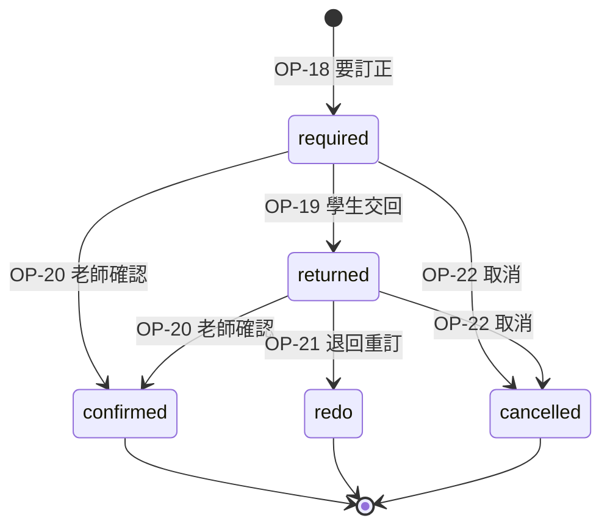
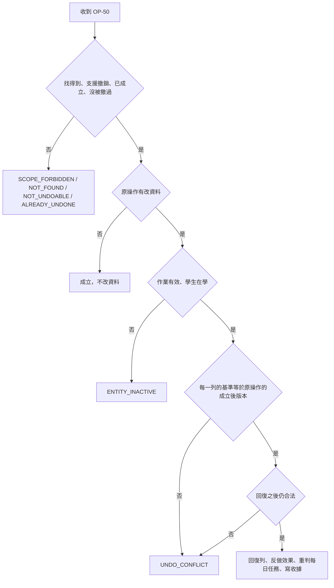

# 呼嚕嚕小鎮 改版操作規格 v0.4（第六到八節）

> 本規格分三份：`01-操作規格-v0.4-總則.md`（第一到五節）、`02-操作規格-v0.4-操作與點數.md`（第六到八節）、`03-操作規格-v0.4-連線讀取與未決.md`（第九到十七節）。節號全文共用，跨檔引用以節號為準。

## v0.4 主要變更

依主控 2026-11-15 20:25 裁定（畫面規劃 `05-v0.2-主控裁定.md` 第十二節）：平板改學生點收模式，用老師的登入。編號只退役、不重排。

1. 6.3：OP-15 的「誰」改成 T。拿掉「學生屬於配對的小組」「作業截止日是今天」兩項伺服器檢查，其餘前提不變。不加來源標記，識別字 `submission.propose`、`leader_proposal` 不改名，說明改成「學生點收模式送的提議」。OP-12、OP-14、OP-16 與表後說明的「小組長提議」照改，畫面上的「小組長待確認」改成「學生點收待確認」。節名改成「作業、繳交、學生點收提議」。
2. 6.3：保留 `only_if_no_proposal`，拿掉 `only_if_group_not_in_use`（OP-14 的輸入與表後那一段）。表後改寫成殘餘說明：學生還在收、還沒送出提議的那一隊，伺服器不擋老師一次記成準時。
3. 6.10：節名改成「評語（配對已移除）」。OP-48、OP-49 標已移除、編號保留，配對碼八點刪除。
4. 8.2：OP-14、OP-16 那一列的提議者改成老師（學生點收模式），撤銷規則不變。
5. 6.3（第一輪審查修正，2026-11-15，主控裁定 12.9）：OP-15 的收回（`pending`）有自己的效果：不建待確認項目，只把尚未處理的提議標成被取代，沒有提議就照樣成立、不改資料，只驗繳交紀錄存在而且參與中。表後加一段：改提議與收回一律新增一筆 OP-15，先前那筆不改不刪、照順序送。

## v0.3 主要變更

1. 第八節照撤銷做法的三方會議結論重寫：可傳遞的基準、撤銷新建的繳交保留一列但不參與、撤銷訂正前先查未結束的輪次、全部預檢通過才動資料。三個驗算案例移到第十六節，另加七個必推順序與兩份提案的證偽順序。
2. 6.11：小野的呼叫先分新舊操作，只有新操作會被暫緩、確認、算進這一批。同一次呼叫裡同一位學生同一條規則出現兩次，整次暫緩，老師確認後只成立一次。
3. 6.12、6.13：OP-53 改成設定型，帶繳交的版本條件，同一交易推進繳交的版本與基準。連結的交易日期不得早於作業發布日。候選清單預設只列「作業遲交」「作業缺交」。
4. 7.4：目前學期缺值時用正式切換日推算。匯入時的版本欄位寫明（7.4 I）。
5. 7.5：轉換器找到的唯一候選先標成候選，正式匯入前由主控逐筆接受或否決，接受的才連結（7.5 H）。同名手動規則金額和候選相同時不列候選。6.5 每日任務只算參與中的繳交。
6. 6.3：OP-14 加兩個選填旗標，只給點收時自動記成準時的人帶。`only_if_no_proposal` 遇到尚未處理的小組長提議就拒絕，`only_if_group_not_in_use` 遇到所屬小組正在用平板就拒絕（畫面規劃 T-603 審查帶回）。
7. 8.3：撤不了的原因是後來被別人改過、原操作是訂正時，依那一輪現在的狀態只列 6.6 走得到的路。

## 六、操作清單

### 6.1 讀表方式

- 「誰」欄用 2.1 的代號。沒列到的角色呼叫，一律回 `FORBIDDEN_ROLE`。
- 「型」欄：設＝設定型，必帶 `expect`，可能回 `STALE_STATE`。加＝累加型，不帶 `expect`。
- 「判定鍵」欄寫的是「同一效果只發生一次」靠什麼保證。寫「只靠 `op_id`」表示這種操作沒有自然的判定鍵，不同編號送兩次就會發生兩次。
- 「撤銷」欄：可＝可用 OP-50 撤銷，效果寫在第八節。否＝回 `NOT_UNDOABLE`，括號內是替代做法。
- 每種操作都可能回的錯誤碼不重複列：`INVALID_PAYLOAD`、`FORBIDDEN_ROLE`、`SCOPE_FORBIDDEN`、`NOT_FOUND`、`ID_CONFLICT`、`CLASS_ARCHIVED`，以及 5.1 全部。「專屬錯誤碼」欄只列額外的。
- 所有操作的目標都只在本班範圍內查找，檢查順序照 2.6。表格不逐列重複這一點。
- 所有操作都會在操作紀錄留一列：誰（資料庫填）、何時、哪種操作、輸入內容、改前改後、收據。

### 6.2 班級、學生、小組

| 編號 | `type` | 誰 | 型 | 輸入 | 資料庫效果 | 判定鍵 | 撤銷 | 專屬錯誤碼 |
|---|---|---|---|---|---|---|---|---|
| OP-01 | `class.create` | T | 加 | `class_id`、學年、班名、老師名、別名、學生人數、`student_ids[]`、`inherit_from_class_id`（可空） | 建班級、擁有者、學生（座號 1 到 N、預設姓名「N號村民」、未分組）、每人一個餘額 0 的帳戶、預設設定與預設規則。有承接來源時，呼叫者必須也是來源班級的擁有者（2.6）。通過後照舊版的承接規則（`src/utils/classInherit.js:24-32`、`:90-119`）：複製職務、手動規則、規則分類、幣別、三條事件規則的金額、任務類型、小組名稱、商店名稱與圖示、商品（庫存回到初始庫存）、座位表的尺寸與視角與物件。值日職務只在它被一併複製時保留。不複製學生、職務指派、值日生名單、公告、座位上的學生、學期區間、目前學期 | `class_id` | 否（改用 OP-03 封存） | `CLASS_FORBIDDEN`（來源班級不是自己的，或不存在） |
| OP-02 | `class.update_info` | T | 設 | 班名、別名、老師名、學年 | 更新班級列 | 版本條件 | 否（再改一次） | `STALE_STATE` |
| OP-03 | `class.set_status` | T | 設 | `status`：`active` 或 `archived` | 更新班級狀態。封存後除了本操作，其他寫入都回 `CLASS_ARCHIVED` | 版本條件 | 否（再設回 `active`） | `STALE_STATE` |
| OP-04 | `student.add` | T | 加 | `student_id`、座號、姓名、小組（可空） | 新增學生與餘額 0 的帳戶。不補指派已存在的作業 | `student_id`。同班在學學生座號不得重複 | 否（改用 OP-06） | `INVALID_PAYLOAD`（座號重複） |
| OP-05 | `student.update_profile` | T | 設 | `student_id`，以及要改的欄位：姓名、座號、頭像 | 更新學生列 | 版本條件 | 否（再改一次） | `STALE_STATE` |
| OP-06 | `student.set_enrollment` | T | 設 | `student_id`、`enrollment_status`：`enrolled`、`home_study`、`transferred`、`archived` | 更新在學狀態。不刪任何紀錄。轉出與封存的學生不能再被加扣分、購買、指派作業 | 版本條件 | 否（再設回去） | `STALE_STATE` |
| OP-07 | `student.set_exempt_rules` | T | 設 | `student_id`、`rules[]`（每條含關鍵字與任務類型） | 整份取代該生的自動免交規則。只影響之後建立的作業 | 版本條件 | 否（再存一次） | `STALE_STATE` |
| OP-08 | `group.assign_students` | T | 設（例外） | `items[]`，每項含 `student_id`、`group_key`（可為 `unassigned`）、`expect`。不帶頂層的 `expect` | 只更新列出的學生。同一位學生不得在 `items` 裡出現兩次，否則回 `INVALID_PAYLOAD`。所有項目的版本條件先對操作前的狀態逐一驗證，全部通過才一次套用。任何一項不符，整筆操作不成立，`current` 列出不符的項目 | 每項的版本條件 | 否（再指派一次） | `STALE_STATE` |
| OP-09 | `group.save` | T | 設 | `group_key`、組名、組長 `leader_student_id`（可空） | 新增或更新小組列 | 版本條件（新建用 `rev` 0） | 否（再改一次） | `STALE_STATE` |

OP-05、OP-06、OP-07、OP-08 改的是同一列學生資料，共用同一個 `rev`。OP-08 是 2.5「設定型操作必帶頂層 `expect`」的唯一例外，共通的輸入檢查要認得它。

學生資料不設性別欄位（主控 2026-11-15 裁定）。舊版的學生資料有 `gender`，但沒有任何畫面讓老師選，也沒有任何邏輯讀它：建班時一律寫 `neutral`（`src/App.jsx:60`），護照存檔時缺值補 `male`（`src/components/modals/PassportModal.jsx:14`、`:64`）。新版不承接成欄位，舊值只留在轉換的原始資料（`server/migration/README.md:37`）。

### 6.3 作業、繳交、學生點收提議

| 編號 | `type` | 誰 | 型 | 輸入 | 資料庫效果 | 判定鍵 | 撤銷 | 專屬錯誤碼 |
|---|---|---|---|---|---|---|---|---|
| OP-10 | `task.create` | T | 加 | `task_id`、標題、類型、頁碼文字（可空）、發布日、截止日、`assignee_ids[]`（省略表示全部在校學生） | 建作業（學期依發布日照 2.4 與 12.3 的月份規則）。替每位指派對象建一筆繳交紀錄，`rev` 為 1、`last_op_id` 為本操作。符合該生自動免交規則的設為 `exempt`，其餘 `pending`。名單就此固定，之後學生異動不回頭改 | `task_id` | 否（改用 OP-12） | 無 |
| OP-11 | `task.update` | T | 設 | `task_id`，以及要改的欄位：標題、類型、頁碼、截止日 | 更新作業列。改截止日不重算任何已發生的加扣分 | 版本條件 | 否（再改一次） | `STALE_STATE`、`ENTITY_INACTIVE` |
| OP-12 | `task.void` | T | 設 | `task_id`、`reverse_effects`（必填布林，15.1 Q8） | 作業標成作廢，不刪任何列。`reverse_effects` 為 `true` 時，把這份作業所有仍有效的效果逐一沖回（原金額）。未裁決的歷史效果不沖回，列在 `result.unresolved_legacy_effects`（6.13）。為 `false` 時點數完全不動。該作業尚未處理、學生點收模式送的提議全部標成被取代。不重新判定每日任務獎勵 | 版本條件 | 否（改用 OP-13。已沖回的點數不會自動加回） | `STALE_STATE` |
| OP-13 | `task.restore` | T | 設 | `task_id` | 作廢的作業恢復成有效。繳交狀態與點數都不動 | 版本條件 | 否（再作廢一次） | `STALE_STATE`、`INVALID_TRANSITION` |
| OP-14 | `submission.set_status` | T、A | 設 | `task_id`、`student_id`、`status`：`pending`、`on_time`、`late`、`missing`、`leave`、`exempt`、`makeup`。選填 `only_if_no_proposal`（布林，預設是 false，見本節末段） | 更新繳交狀態，照 6.4 的矩陣沖回與新增效果，再照 6.5 判定每日任務獎勵。這筆繳交尚未處理、學生點收模式送的提議標成被取代。繳交紀錄不存在（舊資料或後來加入的學生）時建立，是不參與的列（2.5）時重新建立，版本條件怎麼帶見 2.5。繳交帶有未裁決的歷史效果時只能改成 `makeup`（6.13） | 版本條件。加扣分另由效果紀錄的唯一限制保證（6.4） | 可 | `STALE_STATE`、`ENTITY_INACTIVE`、`LEGACY_EFFECT_UNRESOLVED` |
| OP-15 | `submission.propose` | T | 加 | `task_id`、`student_id`、`proposed_status`：`on_time`、`late`、`missing`，或 `pending`（收回提議） | 學生點收模式送的提議（2.1），分提議與收回兩種。**提議**（`on_time`、`late`、`missing`）：建一筆待確認項目（種類 `leader_proposal`，識別字沿用不改名，編號就是本操作的 `op_id`）。同一筆繳交先前尚未處理的提議標成被取代。伺服器驗：作業未作廢、繳交紀錄存在而且參與中（不參與的列和不存在一樣回 `NOT_FOUND`，2.5）、繳交狀態目前是 `pending`。**收回**（`pending`）：不建待確認項目。同一筆繳交有尚未處理的提議，就標成被取代；沒有就照樣成立、不改任何資料，收據的 `result.noop` 是 `true`（同 2.5 的不改資料規則）。老師已經記過時，提議早已被取代，收回的目的已經達到，所以收回不驗作業作廢與繳交狀態，只驗繳交紀錄存在而且參與中（主控裁定 12.9 第 1、2 點）。兩種都不改繳交狀態、版本與點數；待確認項目的狀態仍只有尚未處理、已確認、已退回、被取代四種。不加來源標記，操作種類本身就說明來源（送出端只在學生點收模式送 OP-15）。v0.3 的兩項範圍檢查（學生屬於配對的小組、作業截止日是今天）已移除（2026-11-15，學生點收模式），畫面只列今天到期的作業，伺服器不驗截止日。所以前一天留在待送清單、隔天才送到的提議，只要學生仍是待收就照常成立，老師在待確認視窗處理（主控裁定第 4、7 條） | 同一筆繳交同時只有一筆尚未處理的提議（部分唯一索引） | 否（再提議一次即取代） | `INVALID_TRANSITION`、`ENTITY_INACTIVE` |
| OP-16 | `confirmation.confirm` | T | 加 | `confirmation_id` | 種類是學生點收模式送的提議：以老師身分執行等同 OP-14 的狀態變更與效果，項目標成已確認。種類是小野暫緩批次：照 6.11 逐筆重跑檢查後執行，每筆各自得到最終結果，操作者仍記為小野，項目標成已確認 | 待確認項目只能處理一次（狀態必須是尚未處理） | 學生點收模式送的提議：可（同 OP-14）。小野批次：否（改用 OP-51） | `CONFIRMATION_NOT_PENDING` |
| OP-17 | `confirmation.reject` | T | 加 | `confirmation_id` | 項目標成已退回。小野暫緩批次裡的每筆操作定案為 `rejected` 加 `CONFIRMATION_REJECTED` | 同上 | 否 | `CONFIRMATION_NOT_PENDING` |

統一規劃把「學生點收待確認」列為繳交狀態之一。本規格的做法是繳交狀態欄維持原值（`pending`），另存一筆待確認項目。畫面看到這筆繳交有尚未處理的提議，就顯示成「學生點收待確認」。這樣老師確認前後的狀態與扣分都只有一條路（OP-14 的矩陣）。

老師想記成和提議不同的狀態時，直接用 OP-14，提議會自動被取代。老師「一次確認整組」在畫面上是一個按鈕，送出的是每筆提議各一筆 OP-16，放在同一個請求裡。

**改提議與收回一律新增一筆 OP-15**（主控裁定 12.9 第 3 點，畫面規劃 T-603 學生點收模式第一輪審查 F2）：學生在學生點收模式改點別的狀態或收回時，送出端建立新的一筆 OP-15，新編號、新排序號。先前那筆不論是待送、送出中，還是回應遺失，都不改內容、不刪、不放棄，照 4.4 第 4 點的順序先送，後到的那筆取代它。這樣不會撞 `OP_ID_REUSED`（3.3），也不會發生「以為刪掉了，先前那筆後來又成立」。畫面顯示最後一筆的預估結果。同一位學生同一份作業的一串提議一起被拒絕時，「需要處理」照 9.2 合併成一則。

**點收「其餘記成準時」不得蓋掉剛到的提議**（主控 2026-11-15 裁定，畫面規劃 T-603 第二版複審 F1）：學生點收模式送的提議（OP-15）不改繳交的版本，所以老師帶舊版本送出的 OP-14 仍會通過，並把剛到的提議標成被取代。老師在點收畫面明確點過的人照這個規則走（老師直接定）。畫面替「沒被點、自動記成準時」的人送 OP-14 時帶 `only_if_no_proposal: true`：伺服器在班級鎖內、版本條件通過之後，查這筆繳交有沒有尚未處理的提議，有就回 `STALE_STATE`，什麼都不改，收據的 `current` 除了繳交的目前值，另帶那筆提議的狀態與送出時間（v0.4 拿掉「小組」：提議者是老師帳號，學生屬於哪一隊畫面自己知道）。提議不推進繳交版本的規則不變，否則每筆提議都會讓老師先前的操作撤不了（8.1 第 3 步）。

**`only_if_group_not_in_use` 已移除（2026-11-15，學生點收模式）。** v0.3 這一段要伺服器查學生所屬小組的配對是不是使用中。配對拿掉之後，伺服器不知道哪一隊正在用學生點收模式，也不另外造這種狀態（主控裁定第十二節第 6 條）。

**殘餘（接受）：學生還在收的那一隊。** 學生還在收、還沒送出提議的那一隊，伺服器不擋老師一次記成準時：畫面替那一隊「沒被點、自動記成準時」的人送 OP-14 時，那幾位學生沒有提議，`only_if_no_proposal` 不會擋，照常成立。之後學生點收模式對這些學生送的提議，因為已經不是待收而被拒絕（OP-15 的前提，`INVALID_TRANSITION`）。已經送出提議的學生，仍由 `only_if_no_proposal` 擋下。老師要先收別隊時，手動關掉學生正在收的那一隊，這是畫面的做法，不是伺服器檢查。

### 6.4 繳交狀態轉換與加扣分

事件與效果紀錄：

- 自動加扣分由「事件規則」決定（第十二節）。和繳交有關的事件有三個：`submission.late`（遲交）、`submission.missing`（缺交）、`daily_quest.complete`（每日任務獎勵）。
- 每次自動加扣分都寫一筆效果紀錄：學生、事件、對象（作業或日期）、套用的規則編號與版本、產生的根交易、狀態、來源 `origin`（`op` 或 `legacy`）、接替鏈編號 `lineage_id`。
- 狀態有四種：`active`（有效）、`reversed`（已沖回）、`legacy_unresolved`（歷史效果未裁決）、`dismissed`（老師裁決為當時沒有扣分）。後兩種只會出現在舊資料（6.13）。
- 唯一限制：同一位學生、同一事件、同一對象，同時只能有一筆有效的效果（部分唯一索引）。已沖回的不算，所以缺交改準時再改回缺交，會再扣一次。
- 沖回＝寫一筆 `reversal` 交易，金額是「該效果那筆根交易目前有效金額」的相反數（7.3），並把效果標成已沖回。不看現在的規則金額。有效金額已經被改成 0 時照樣寫一筆金額 0 的沖回、效果標成已沖回（7.3），不得留下有效的 0 元效果。
- 事件沒有現行規則，或規則金額是 0：不寫交易，也不寫效果紀錄。
- **接替鏈。** 新產生的效果，`lineage_id` 等於它自己的編號。撤銷時補回的效果沿用被補回那一筆的 `lineage_id`（8.1）。同一條鏈上同時最多一筆有效。
- **收據要記兩份清單。** `result.effects_added` 記這筆操作新增的每個效果：效果編號、`lineage_id`、事件、對象、根交易編號、新增時的金額。`result.effects_reversed` 記它沖回的每個效果與當時的快照：效果編號、`lineage_id`、事件、對象、規則編號與版本、根交易編號、沖回前的有效金額、根交易的 `effective_at`。撤銷只看這兩份清單，不重新套用規則。每日任務獎勵也照實記在清單裡，但撤銷不照它反做，改成重新判定（8.1）。

每個狀態「應該有效」的扣分：`late` 是遲交扣分，`missing` 是缺交扣分，其餘狀態沒有。`makeup`（補交）是例外：改成補交時什麼都不動，先前的扣分原樣保留。

從原狀態改成新狀態時（新狀態不是 `makeup`）：把這筆繳交目前有效、但新狀態不該有的扣分沖回。新狀態該有、但目前沒有有效的，就新增。展開如下（舊資料的 `unknown` 視同 `pending`）：

| 原狀態 ＼ 新狀態 | `pending`、`on_time`、`leave`、`exempt` | `late` | `missing` | `makeup` |
|---|---|---|---|---|
| `pending`、`on_time`、`leave`、`exempt` | 無 | 新增遲交扣分 | 新增缺交扣分 | 無 |
| `late` | 沖回遲交扣分 | 不適用 | 沖回遲交扣分，新增缺交扣分 | 無，遲交扣分保留 |
| `missing` | 沖回缺交扣分 | 沖回缺交扣分，新增遲交扣分 | 不適用 | 無，缺交扣分保留 |
| `makeup`（帶著保留下來的扣分） | 沖回保留的扣分（15.1 Q9） | 保留的是遲交扣分就不動。是缺交扣分就沖回並新增遲交扣分 | 保留的是缺交扣分就不動。是遲交扣分就沖回並新增缺交扣分 | 不適用 |

「狀態是缺交但缺交扣分已被沖回」是允許存在的狀態（老師用 OP-27 單獨沖回那筆扣分，或用 OP-12 作廢時選了沖回）。之後再有狀態變更，照上面同一條規則處理。

矩陣判斷「目前有沒有有效的扣分」時，新版效果與已對應的歷史效果一視同仁。繳交帶有未裁決的歷史效果時不進矩陣，照 6.13。

不參與的繳交（2.5）在矩陣裡當成原狀態 `pending`、沒有任何扣分。重新建立它就是從 `pending` 改成新狀態。

### 6.5 每日任務獎勵

- 「某位學生在某一天的每日任務」指：截止日是那一天、沒有作廢、而且這位學生有參與中（`assignment_active` 為 true）的繳交紀錄的所有作業。不參與的繳交（2.5）不算，等同這位學生沒有這份作業。
- 達成條件：這些繳交全部都是 `on_time`、`makeup`、`leave`、`exempt` 之一，而且至少一筆是 `on_time`。
- 判定時機：只有在這位學生那一天的任一筆繳交狀態變更成立之後（OP-14、OP-16，以及它們的撤銷，含撤銷新建、重新建立不參與的列），在同一個資料庫交易內判定。建立、作廢、恢復作業都不觸發判定。
- 判定結果：條件成立而且沒有有效的獎勵效果，就新增（事件 `daily_quest.complete`，對象是那一天的日期），金額用提交當下的現行規則。條件不成立而有有效的獎勵效果，就沖回。
- 和操作當天是哪一天無關：補登上週的繳交狀態，判定的是上週那一天的獎勵（15.1 Q1）。
- 撤銷之後的重判也照這一節：期間改過每日任務規則的金額時，補發的是新金額，學生餘額不保證回到撤銷前的原點，收據照實記交易，畫面顯示實際差額（8.1）。
- **舊資料的界線。** 這位學生那一天的每日任務裡，只要有一筆繳交是轉換進來的、而且轉換當下的狀態不是 `pending`（欄位 `legacy_status_at_import`，7.5），那一天就不做自動判定：不新增也不沖回，收據的 `warnings` 帶 `LEGACY_DAY_NO_DAILY_QUEST`。理由：舊版的獎勵記在操作當天，不記是哪一天的作業（`src/views/DashboardView.jsx:327`、`:408`），新版無法判斷那一天是不是已經發過。老師要補發或收回，用 OP-24 或 OP-27。轉換進來但舊版還沒點收過的作業（全部是 `pending`）不受這條限制。已知的殘餘：舊版某天記了準時並發了獎勵，隔天才改回待收時，舊版不會回收那筆獎勵（它只看操作當天，`:327-328`）。這種紀錄轉進來是待收，新版不會凍結那一天，之後再記成準時會多發一次。轉換報告要列出「仍有效的每日任務獎勵筆數多於達成條件的日數」的學生，供主控在正式切換時核對。

### 6.6 訂正

訂正項目的單位是「哪份作業、哪位學生、第幾輪」。一輪的狀態如下：



| 編號 | `type` | 誰 | 型 | 輸入 | 資料庫效果 | 判定鍵 | 撤銷 | 專屬錯誤碼 |
|---|---|---|---|---|---|---|---|---|
| OP-18 | `correction.require` | T、A | 加 | `correction_id`、`task_id`、`student_id`、期限 `due_on`（可空）、備註 | 建一輪訂正，狀態 `required`，輪次是該生該作業現有最大輪次加一 | 同一位學生同一份作業同時只有一輪未結束（`required` 或 `returned`）的訂正（部分唯一索引）。另有（作業、學生、輪次）唯一 | 可 | `INVALID_TRANSITION`（已有未結束的一輪）、`ENTITY_INACTIVE` |
| OP-19 | `correction.mark_returned` | T、A | 設 | `correction_id` | `required` 改成 `returned` | 版本條件 | 可 | `STALE_STATE`、`INVALID_TRANSITION` |
| OP-20 | `correction.confirm` | T | 設 | `correction_id` | `required` 或 `returned` 改成 `confirmed`。有 `correction.confirmed` 事件規則時新增效果（對象是這一輪訂正） | 版本條件。效果同時只有一筆有效 | 可 | `STALE_STATE`、`INVALID_TRANSITION` |
| OP-21 | `correction.redo` | T | 設 | `correction_id`、`next_correction_id`、下一輪期限（可空） | 這一輪改成 `redo`，同時建下一輪（狀態 `required`） | 版本條件。`next_correction_id` | 可（下一輪的基準仍是 1，也就是之後的改動都已撤回，8.2） | `STALE_STATE`、`INVALID_TRANSITION` |
| OP-22 | `correction.cancel` | T | 設 | `correction_id`、`reverse_effects`（必填布林，15.1 Q8） | 未結束的一輪改成 `cancelled`。`reverse_effects` 為 `true` 時沖回這一輪仍有效的效果（例如逾期扣分） | 版本條件 | 可 | `STALE_STATE`、`INVALID_TRANSITION` |
| OP-23 | `correction.set_due` | T | 設 | `correction_id`、`due_on`（可空） | 改期限。已發生的逾期扣分不動，也不會因為改期限再扣一次（12.4） | 版本條件 | 否（再改一次） | `STALE_STATE`、`INVALID_TRANSITION` |

舊資料裡類型是「訂正」的舊任務維持一般作業的樣子，不會自動變成訂正項目。舊版沒有訂正項目，所以訂正的兩個事件不需要歷史效果。

### 6.7 點數、發薪、值日

| 編號 | `type` | 誰 | 型 | 輸入 | 資料庫效果 | 判定鍵 | 撤銷 | 專屬錯誤碼 |
|---|---|---|---|---|---|---|---|---|
| OP-24 | `points.adjust` | T | 加 | `student_id`、`amount`（非零整數，絕對值不超過 100000）、理由（最多 100 字，空白時記「手動調整」） | 寫一筆 `adjust` 交易 | 只靠 `op_id` | 可 | `ENTITY_INACTIVE` |
| OP-25 | `points.apply_rule` | T、A | 加 | `student_id`、`rule_id`、`rule_version` | 規則必須是手動規則、未停用、而且 `rule_version` 是現行版本。寫一筆 `adjust` 交易，金額與理由取自該版本 | 只靠 `op_id`。小野另受 6.11 的上限約束 | 可 | `RULE_VERSION_STALE`、`ENTITY_INACTIVE` |
| OP-26 | `tx.correct` | T | 加 | `transaction_id`、`new_amount`（整數）、理由、`expect_effective_amount` | 先找到根交易（7.3），確認它目前的有效金額等於 `expect_effective_amount`，再寫一筆 `correction` 交易，金額是 `new_amount` 減目前有效金額。差額為 0 但有理由時仍寫一筆金額 0 的更正，當成備註 | `expect_effective_amount` 不符回 `STALE_STATE` | 可（等於把這筆更正沖回） | `STALE_STATE`、`TX_NOT_REVERSIBLE`、`TX_ALREADY_REVERSED` |
| OP-27 | `tx.reverse` | T | 加 | `transaction_id`、`expect_effective_amount` | 找到根交易，寫一筆 `reversal` 交易，金額是目前有效金額的相反數。根交易連著效果紀錄時（含已對應的歷史效果），把效果標成已沖回 | 一筆根交易只能有一筆 `reversal`（部分唯一索引） | 否（重新加扣一次） | `STALE_STATE`、`TX_NOT_REVERSIBLE`、`TX_ALREADY_REVERSED` |
| OP-28 | `payroll.run` | T | 加 | `job_ids[]`、`pay_date`（省略表示今天）、`include_legacy_periods`（布林，省略表示 `false`） | 對每個未停用的職務、每位被指派而且在校或在家自學的學生，薪資不是 0 就寫一筆 `payroll` 交易與一筆效果紀錄（事件 `payroll`，對象是職務加期別）。三種情況跳過並列在 `result.skipped`，各附原因：已發過（`already_paid`）、是值日職務（`duty_job`）、是跨切換日的期別而且沒帶 `include_legacy_periods`（`legacy_period`） | 同一位學生、同一職務、同一期別同時只有一筆有效的發薪效果。期別由職務週期與 `pay_date` 決定：每日用日期、每週用 ISO 週（例 `2026-W47`）、每月用年月、每學期用學期代號、一次性固定為 `once` | 可（撤銷後同一期可以再發） | 無 |
| OP-29 | `duty.set` | T | 設 | 日期、`student_ids[]` | 新增或整份取代那一天的值日生名單。已發的值日薪資不動 | 版本條件（每天一列，新建用 `rev` 0） | 否（再設一次） | `STALE_STATE` |
| OP-30 | `duty.pay` | T | 加 | 日期、`include_legacy_periods`（布林，省略表示 `false`） | 對那一天的每位值日生寫一筆 `payroll` 交易與效果紀錄（事件 `duty_pay`，對象是日期），金額是值日職務的薪資。已發過的跳過。日期早於切換日而且沒帶 `include_legacy_periods` 時整筆成立但不發，全部列在 `result.skipped`（原因 `legacy_period`）。沒設定值日職務或那天沒有名單，回 `INVALID_TRANSITION` | 同一位學生同一天同時只有一筆有效的值日薪資效果 | 可 | `INVALID_TRANSITION` |

- **值日薪資只有 OP-30 一個入口。** 設定鍵 `dutyJobId` 指到的職務不由 OP-28 發放，出現在 `job_ids` 裡就跳過。所以 OP-28 與 OP-30 交叉送，同一位值日生同一天也只會領一次。
- **跨切換日的期別。** 轉換進來的班有一個切換日（7.5）。舊版的薪資交易不記期別（理由只有職稱與週期，`src/components/modals/settings/JobSettingsTab.jsx:110`），新版無法判斷切換那一期舊版是不是已經發過。所以期別的第一天早於切換日時（一次性職務則是「這個職務是轉換進來的」），預設不發。畫面把這些職務列出來，請老師看過存摺後選「仍要發放」，送一筆帶 `include_legacy_periods` 為 `true` 的新操作。切換日之後才開始的期別不受影響。新建的班沒有切換日，也不受影響。
- OP-26、OP-27 不能用在：`migration_opening_adjustment`、`legacy_orphan_correction`、金額 0 的 `item_use`，這些回 `TX_NOT_REVERSIBLE`。新版的 `shop_purchase` 不能用 OP-27 沖回（那樣道具與庫存不會跟著回復），要用 OP-50 撤銷購買。舊資料的購買交易沒有對應的操作，允許用 OP-27 只退點數。
- OP-24、OP-25 沒有自然的判定鍵：同一件事老師按一次、小野再套一次，會加兩次。本規格的處理是提示而不是阻擋：同一位學生、同一條規則在 10 分鐘內已有另一位操作者套用過時，收據的 `warnings` 帶 `POSSIBLE_DUPLICATE`，畫面與小野都要顯示出來。小野這一邊另有 6.11 的當日重複暫緩。
- 點數可以是負的。扣分、沖回、更正都不檢查餘額，只有購買檢查。

### 6.8 商店與背包

| 編號 | `type` | 誰 | 型 | 輸入 | 資料庫效果 | 判定鍵 | 撤銷 | 專屬錯誤碼 |
|---|---|---|---|---|---|---|---|---|
| OP-31 | `shop.purchase` | T | 加 | `student_id`、`product_id`、`item_id`、`expect_price_points` | 伺服器用現行幣別把商品價格換成積分，必須等於 `expect_price_points`。餘額不得低於價格。庫存必須大於 0（舊資料的空值視同 0，和舊版畫面把它顯示成售完一致，`src/components/modals/OrangeCatStoreModal.jsx:123`）。成立時在同一交易內：寫 `shop_purchase` 交易（負的價格）、建背包物品（記商品編號、當時的品名與圖示、購買交易編號）、庫存減一 | `item_id`。其餘只靠 `op_id` | 可（道具還沒用掉才行） | `INSUFFICIENT_BALANCE`、`OUT_OF_STOCK`、`PRICE_CHANGED`、`ENTITY_INACTIVE` |
| OP-32 | `inventory.use` | T | 加 | `item_id` | 物品狀態從持有改成已使用，寫一筆金額 0 的 `item_use` 交易 | 物品狀態必須是持有 | 可 | `ITEM_ALREADY_USED`、`INVALID_TRANSITION`（已退回的物品） |
| OP-33 | `product.save` | T | 設 | `product_id`、品名、圖示、價格、價格單位、庫存（非負整數）、初始庫存、說明 | 新增或更新商品 | 版本條件（新建用 `rev` 0） | 否（再改一次） | `STALE_STATE` |
| OP-34 | `product.retire` | T | 設 | `product_id` | 商品標成停用，不能再買。已買的物品不受影響 | 版本條件 | 否（用 OP-33 重新啟用） | `STALE_STATE` |

購買會改商品的庫存，所以商品列的 `rev` 也會加一。購買本身不帶商品的版本條件，只比價格，連續買兩件不會互相擋住。購買與使用道具在畫面上要等收到 `committed` 才算完成（4.4 第 11 點）。

### 6.9 職務、規則、公告、座位、設定

| 編號 | `type` | 誰 | 型 | 輸入 | 資料庫效果 | 判定鍵 | 撤銷 | 專屬錯誤碼 |
|---|---|---|---|---|---|---|---|---|
| OP-35 | `job.save` | T | 設 | `job_id`、職稱、薪資、圖示、週期、分類 | 新增或更新職務。改薪資不影響已發的薪資 | 版本條件 | 否 | `STALE_STATE` |
| OP-36 | `job.retire` | T | 設 | `job_id` | 職務標成停用，指派紀錄保留。它是值日職務時，同時清掉值日職務設定 | 版本條件 | 否（用 OP-35 重新啟用） | `STALE_STATE` |
| OP-37 | `job.set_assignees` | T | 設 | `job_id`、`student_ids[]` | 整份取代該職務的指派名單 | 職務列的版本條件 | 否（再設一次） | `STALE_STATE`、`ENTITY_INACTIVE` |
| OP-38 | `rule.save` | T | 設 | `rule_id`、種類（手動或事件）、事件代號（事件規則才有）、名稱、金額、圖示、分類 | 新增一個規則版本（版本號加一，提交當下生效），舊版本保留不改（12.1） | 版本條件（`rev` 就是版本號）。同一班同一事件代號只能有一條未停用的事件規則 | 否（再存一版） | `STALE_STATE` |
| OP-39 | `rule.retire` | T | 設 | `rule_id` | 規則標成停用。已發生的交易與效果不動 | 版本條件 | 否（用 OP-38 重新啟用） | `STALE_STATE` |
| OP-40 | `announcement.save` | T | 設 | `announcement_id`、文字、顏色、角度 | 新增或更新一則公告 | 版本條件 | 否 | `STALE_STATE` |
| OP-41 | `announcement.remove` | T | 設 | `announcement_id` | 公告標成已移除，不實體刪除 | 版本條件 | 否（用 OP-40 重新啟用） | `STALE_STATE` |
| OP-42 | `seating.save` | T | 設 | 列數、行數、視角、座位對照、物件對照、自訂物件 | 整份取代這個班的座位表。座位對照裡的學生必須都存在 | 座位表列的版本條件（每班一列） | 否（再存一次） | `STALE_STATE` |
| OP-43 | `setting.set` | T | 設 | `key`、`value` | 整份取代這個設定鍵的值。可用的鍵固定為：`taskTypes`、`ruleCategories`、`currency`、`semesterPeriods`、`currentSemester`、`shopMeta`、`dutyJobId`、`agentLimits`、`correctionOverdueGraceDays` | 每個鍵各自的版本條件 | 否（再設一次） | `STALE_STATE` |

- 改幣別匯率不重算任何已發生的交易。交易一律以積分保存。
- 規則分類只是名稱清單。刪掉一個分類不連帶改規則，畫面找不到分類時顯示「未分類」。
- 舊版的遲交扣分、缺交扣分、每日任務獎勵三個自動化金額，改版後是三條事件規則，用 OP-38 改，不在 OP-43 的鍵裡。

### 6.10 評語（配對已移除）

| 編號 | `type` | 誰 | 型 | 輸入 | 資料庫效果 | 判定鍵 | 撤銷 | 專屬錯誤碼 |
|---|---|---|---|---|---|---|---|---|
| OP-44 | `comment.save` | T | 設 | `student_id`、學期、要改的欄位：觀察紀錄、評語、箴言 | 新增或更新該生該學期的評語列。老師手動存檔不受鎖定限制 | 版本條件（每位學生每學期一列） | 否（再改一次） | `STALE_STATE` |
| OP-45 | `comment.set_lock` | T | 設 | `student_id`、學期、評語鎖定、箴言鎖定 | 更新兩個鎖定旗標 | 版本條件 | 否 | `STALE_STATE` |
| OP-46 | `comment.request_generation` | T | 設 | `student_id`、學期 | 狀態改成產生中。後端把觀察紀錄裡的姓名換成座號代稱後呼叫瓦力 | 版本條件 | 否 | `STALE_STATE`、`COMMENT_LOCKED` |
| OP-47 | `comment.apply_generated` | 系統（後端代瓦力寫入） | 加 | `request_op_id`、`student_id`、學期、產生的評語、箴言、分析、模型名稱，或錯誤訊息 | 評語列現在的 `rev` 仍等於 `request_op_id` 的成立後版本（老師在等待期間沒改過）時，寫入未鎖定的欄位。否則不覆蓋，產生結果另存成建議稿，`result.superseded` 為 `true`。鎖定的欄位一律不寫 | `op_id` 由 `request_op_id` 算出（第 5 版 UUID，只有系統身分能用，3.1），一次請求只會套用一次 | 否 | 無 |
| OP-48 | `pairing.create`：已移除（2026-11-15，學生點收模式） | 不適用 | 不適用 | 不適用 | 平板改用老師的登入進學生點收模式，不再發配對碼 | 不適用 | 不適用 | 不適用 |
| OP-49 | `pairing.revoke`：已移除（2026-11-15，學生點收模式） | 不適用 | 不適用 | 不適用 | 沒有配對可收回 | 不適用 | 不適用 | 不適用 |

評語產生的完整流程在第 3 階段再細化。本版只定兩條不能違反的規則：晚到的產生結果不得蓋掉人工修改。鎖定的欄位不寫。

配對碼與 `POST /api/v2/auth/pair`（v0.3 的八點，15.1 Q13）：已移除（2026-11-15，學生點收模式）。平板與電子白板改用老師的登入，不再用配對碼換權杖（主控裁定第十二節第 5 條）。

### 6.11 小野的呼叫與上限

- 小野能呼叫的操作只有：OP-14、OP-18、OP-19、OP-25，以及用 OP-50 撤銷自己的操作。聯絡簿草稿在第 4 階段加入。
- 呼叫方式是 `agent_submit(class_id, call_id, ops, note)`，一次帶 1 到 50 筆操作。`call_id` 是第 4 版 UUID，由交接手冊的工具產生，重送時不變。
- 整次呼叫是一個資料庫交易，每筆操作用儲存點隔開（2.2）。所以不會有「做到一半」的批次：要嘛整次提交（每筆各有自己的結果），要嘛整次什麼都沒留下。暫時型失敗時，小野用同一個 `call_id` 與同一份清單重送。
- **呼叫紀錄與批次是兩回事。** 伺服器替每個 `call_id` 存一份呼叫紀錄：當時送來的完整清單（每筆的 `op_id`、內容雜湊、順序）與每筆的收據，只用來認重送。**這一批**（`batch_id` 等於 `call_id`）的成員只有這次呼叫的新操作（第 1 步），暫緩、確認、整批撤銷（OP-51）與 `expect_op_count` 都只看這一批。

處理順序固定：

1. **先認重送，再分新舊。**
   - `call_id` 已存在：清單相同（每筆的 `op_id`、內容雜湊、順序都相同）就回呼叫紀錄裡的整批收據，不重新檢查上限、不重新執行。這一批若曾被暫緩、之後已由老師確認或退回，每筆改回處理後的最新結果，不回當時的 `held`。網站的查詢（規格 01 的 4.5）只回老師本人的操作，小野要拿最新結果就走這條重送。清單不同：整次回 `CALL_ID_REUSED`。
   - `call_id` 是新的：清單裡同一個 `op_id` 出現兩次，整次回 `BAD_ENVELOPE`，什麼都不留。否則把清單分成兩組。**既有操作**是 `op_id` 已經登記過的（不論當時成立、暫緩、拒絕或放棄）：照 3.3 各自回原結果或 `OP_ID_REUSED`，永遠留在原來的批次，不參加後面任何一步：不計入上限、不執行、不暫緩、不算進這一批。**新操作**是其餘的，只有它們進第 2 到 6 步。全部都是既有操作時，這次呼叫只回各自的原結果，不建立批次。
2. **看輸入就能判斷的上限。** 只看新操作。任何一條超過就直接走第 5 步，不執行：
   - 這次呼叫影響的學生數超過 `max_students_per_call`。
   - 最近 10 分鐘內小野已成立的操作、最近 10 分鐘內建立而且還在等老師確認的批次、加上這次呼叫，影響的學生合計超過 `max_students_per_10min`（同一位只算一次）。建立超過 10 分鐘的暫緩批次不再計入人數，只受 `max_pending_held` 限制，所以老師晚一點處理不會讓小野整段時間都被暫緩。
   - OP-25 的對象（同一位學生、同一條規則）今天已經被任何人套用過，或已經在等老師確認的批次裡。
   - 新操作裡有兩筆以上 OP-25 的對象相同。第 3 步執行前，這兩筆都查不到今天的套用紀錄，不加這一條就會兩筆都成立。
3. **逐筆執行新操作。** 每筆各自成立或被拒絕，彼此不連動。
4. **用實際結果檢查金額上限。** 不另寫一套預估，直接看這次呼叫實際產生的交易（含遲交缺交扣分、每日任務獎勵與各種沖回）：
   - 任何一筆交易的絕對值超過 `max_points_per_tx`。
   - 任何一位學生今天由小野自行成立的交易，絕對值合計（含這次）超過 `max_points_per_student_per_day`。老師確認後才成立的交易不算進合計。小野撤銷自己的操作（OP-50）產生的交易也不算。
5. **超過就整次暫緩。** 第 2 或第 4 步任何一條超過：新操作全部回復到起點（第 3 步做的全部不算），轉成一筆待確認項目（種類 `agent_held`），記下超過的是哪一條。新操作的收據是 `held` 加 `HELD_FOR_TEACHER`。既有操作的收據仍是它們的原結果。
6. **待確認不能無限堆。** 這個班等老師確認的小野批次已達 `max_pending_held` 時，再有需要暫緩的呼叫，整次回 `HELD_QUEUE_FULL`，什麼都不留。

`agentLimits` 的五個數值（15.1 Q4），只有老師能用 OP-43 改，小野沒有 OP-43 的權限：

| 鍵 | 預設 | 意思 |
|---|---|---|
| `max_students_per_call` | 5 | 一次呼叫最多影響幾位學生 |
| `max_students_per_10min` | 10 | 最近 10 分鐘合計最多影響幾位學生，含還在等老師確認的批次 |
| `max_points_per_tx` | 200 | 單筆交易的點數絕對值上限 |
| `max_points_per_student_per_day` | 300 | 同一位學生當天由小野自行成立的點數變動，絕對值合計上限 |
| `max_pending_held` | 5 | 同一個班最多有幾批在等老師確認 |

老師確認暫緩批次（OP-16）時：

- 只處理這一批的新操作，依原順序逐筆重新走 2.2 第 4 到 6 步的全部檢查：角色與範圍、輸入、版本條件、`RULE_VERSION_STALE`、`ENTITY_INACTIVE`、`LEGACY_EFFECT_UNRESOLVED`。只有本節的五條上限與第 2 步的重複檢查不再看，因為老師已經看過。
- OP-25 沒有版本條件，另外檢查一件事：這位學生這條規則在這一批被暫緩之後已經被任何人套用過，**含同一批排在前面、這次確認剛成立的那一筆**，這一筆就定案為 `rejected` 加 `HELD_OP_OUTDATED`，不執行。所以「老師等不及先自己扣了」不會再被確認扣一次，同一批裡重複的兩筆確認後也只成立一筆。老師真的要加兩次，自己再按一次。
- 成立的操作，操作者仍記為小野，另外記下確認的老師。`batch_id` 不變，所以老師仍可以用 OP-51 整批撤銷，小野也仍可以用 OP-50 撤銷其中自己的操作。
- 老師用 OP-17 退回則全部定案為拒絕。

已知的限制：小野照 10 分鐘 10 人的速度，一節課內仍可能陸續動到全班。本版不另設每日人數上限，理由是每筆都有紀錄、可以整批撤銷，而且單一學生當日的點數變動已經有上限。

### 6.12 撤銷、排程、歷史效果裁決

| 編號 | `type` | 誰 | 型 | 輸入 | 資料庫效果 | 判定鍵 | 撤銷 | 專屬錯誤碼 |
|---|---|---|---|---|---|---|---|---|
| OP-50 | `op.undo` | T、A（只能撤銷自己的） | 加 | `target_op_id` | 見第八節 | 一筆操作只能被一筆成立的撤銷撤銷一次（`target_op_id` 在已成立的撤銷之間唯一，部分唯一索引）。被拒絕的撤銷不佔用 | 否 | `NOT_UNDOABLE`、`ALREADY_UNDONE`、`UNDO_CONFLICT`、`ENTITY_INACTIVE` |
| OP-51 | `batch.undo` | T | 加 | `batch_id`、`expect_op_count`（這一批已成立的操作筆數，8.4） | 見 8.4 | 一批只能被一筆成立的整批撤銷撤銷一次（`batch_id` 在已成立的整批撤銷之間唯一）。被拒絕的不佔用，筆數不符被擋之後重新整理、用新編號再送即可 | 否 | `ALREADY_UNDONE`、`STALE_STATE`（筆數和老師看到的不同） |
| OP-52 | `schedule.correction_overdue` | S | 加 | 日期 | 見 12.4 | `op_id` 由班級、工作名稱、日期算出，同一天只會成立一次。逾期效果每一輪訂正只會發生一次（已沖回的也算發生過，要查這一輪所有的歷史效果列，不能只查有效的） | 否（個別用 OP-27 沖回，或 OP-22 取消時選沖回） | 無 |
| OP-53 | `legacy_effect.resolve` | T | 設 | `effect_id`、`resolution`：`link` 或 `none`。`link` 時另帶 `transaction_id`。繳交狀態是 `makeup` 時另帶 `event`（`submission.late` 或 `submission.missing`，表示保留的是哪一種扣分）。`expect`：那筆繳交的版本條件（2.5） | 見 6.13。`link`：交易必須是同一位學生的舊根交易、`kind` 是 `legacy_general`、有效金額是負數、沒有連著任何效果，而且交易的臺灣日期不早於這份作業的發布日（任何一個日期無法解析也不行）。成立後歷史效果變成 `active`，根交易是這一筆。事件依繳交狀態決定，補交時用輸入的 `event`。`none`：歷史效果標成 `dismissed`。兩種答案都在同一個交易內推進那筆繳交的 `rev` 與 `basis_rev`（2.5 連帶推進），繳交列在 `changes` | 一筆歷史效果只能裁決一次（狀態必須是未裁決）。繳交的版本條件 | 否（選了 `link` 之後要退分用 OP-27。選了 `none` 之後發現其實有扣，直接對那筆舊交易用 OP-27） | `INVALID_TRANSITION`（已裁決過）、`TX_NOT_REVERSIBLE`（交易不符條件，含日期早於作業發布日）、`STALE_STATE` |

### 6.13 歷史效果：舊版已經扣過的分

轉換進來、狀態是 `late`、`missing`、`makeup` 的舊繳交，舊版可能已經扣過分。新版不得因為「這筆繳交沒有新版的效果列」就當成從未扣分。轉換器替每一筆這樣的繳交產生一筆歷史效果（規則在 7.5），匯入後結果只有兩種：

- **已對應**：轉換器找到唯一一筆可能的舊扣分交易（條件與它依賴的假設見 7.5 C、D），而且正式匯入前主控在裁決輸入裡接受了它（7.5 H）。效果是 `active`、`origin` 是 `legacy`、根交易就是那筆舊交易。之後的行為和新版效果完全一樣：缺交改準時會沖回那筆舊交易的金額，缺交改補交再改回缺交不會再扣。
- **未裁決**（`legacy_unresolved`）：候選不唯一、根本沒有候選，或候選被主控否決。系統不猜，等老師在需要時回答。

未裁決的繳交碰到各種操作時：

| 操作 | 結果 |
|---|---|
| OP-14 改成 `makeup`（老師或小野） | 成立。補交本來就不動扣分，歷史效果維持未裁決。學生後來補交是最常見的情況，這條路不必裁決 |
| OP-14 改成其他任何狀態（老師或小野） | 回 `LEGACY_EFFECT_UNRESOLVED`，什麼都不改。老師先用 OP-53 裁決，再送狀態變更 |
| OP-12 作廢並選沖回 | 作業照常作廢。未裁決的歷史效果不沖回，列在 `result.unresolved_legacy_effects`，`warnings` 帶 `LEGACY_EFFECT_SKIPPED` |
| OP-50 撤銷先前「改成補交」的操作 | 中間沒有裁決過：成立，狀態回到原值，歷史效果仍是未裁決。中間用 OP-53 裁決過：OP-53 已推進這筆繳交的基準，撤銷回 `UNDO_CONFLICT`，什麼都不改（16.2 S5）。老師要改回缺交或遲交，用 OP-14 直接改，照 6.4 矩陣處理已裁決的扣分 |
| 6.5 每日任務判定 | 補交照常算通過，和有沒有裁決無關 |

老師裁決用 OP-53（6.12），答案只有兩種：

- `link`：當時有扣，就是存摺裡的這一筆。老師從候選清單選一筆。候選清單是讀取時算出來的：同一位學生、`kind` 是 `legacy_general`、有效金額是負數、還沒連著任何效果、臺灣日期不早於這份作業發布日的舊根交易。畫面預設只列理由是「作業遲交」「作業缺交」的，轉換器列為候選的那一筆（`suggested_transaction_id`，7.5 E）排最前面並標明。老師按「顯示其他扣分」才列出其餘的負數交易。裁決後歷史效果變成已對應。
- `none`：當時沒有扣，或舊版已經退過。裁決後歷史效果標成 `dismissed`，這筆繳交視為沒有有效扣分。

畫面的做法：老師把這種繳交改成補交以外的狀態時，同一個步驟裡先問「這是舊版留下的紀錄，當時有沒有扣分」。老師回答後，送出端在同一個請求裡先放 OP-53（`expect` 帶這筆繳交的 `{"rev": r}`），再放 OP-14（`expect` 帶 `{"after_op": "<OP-53 的 op_id>"}`）。OP-53 會推進繳交的版本，OP-14 若仍帶原本的 `rev` 一定得到 `STALE_STATE`。OP-53 被拒絕時，OP-14 也自然得到 `STALE_STATE`，兩筆一起進「需要處理」。送出端照 4.4 第 6 點找「同一列最後一筆還沒結清的操作」時，OP-53 算是改到那筆繳交的操作：它自己的 `expect` 也照第 6 點帶，後面同一筆繳交的操作接在它之後。

舊繳交的狀態是 `pending`、`on_time`、`leave`、`exempt` 時不產生歷史效果，視為沒有有效扣分。舊版有一條已知的路徑會讓這類繳交仍帶著扣分（補交後改成準時不退分，`src/views/DashboardView.jsx:312-319`）。那些扣分仍在存摺裡，是一般的舊交易，老師可以用 OP-27 沖回。轉換報告會列出「舊扣分交易的筆數多於可能帶扣分的繳交筆數」的學生，供主控在正式切換時核對。

## 七、點數交易

### 7.1 每筆交易的欄位

交易只能新增，不能修改、不能刪除。每筆交易至少有：學生、種類 `kind`、金額 `amount`（影響餘額）、累計增減 `earned_delta`（影響累計加分）、提交時間 `occurred_at`、歸屬時間 `effective_at`（決定算進哪個期間）、根交易 `root_transaction_id`（更正與沖回才有）、來源 `origin`（`op` 或 `migration`）、產生它的操作 `op_id`（只有 `op` 有）、轉換批次（只有 `migration` 有）、理由。`earned_delta` 與 `effective_at` 在寫入當下就算好存進去，之後統計只做加總，不再解讀理由文字。

三個數字的定義：

- **餘額**＝該生所有交易的 `amount` 加總。
- **累計加分**＝該生所有交易的 `earned_delta` 加總。
- **期間統計**（期中、期末、排行榜的期間排名）＝該生 `effective_at` 的臺灣日期落在起訖日（含）之內的交易，`earned_delta` 加總。`effective_at` 是空值的交易不算進任何期間。

帳戶列另存餘額與累計加分兩個數字，和交易在同一個資料庫交易內更新。規則（待驗證）：任何時候帳戶列的兩個數字都等於上面的加總。

### 7.2 交易種類

| `kind` | 什麼時候產生 | 計入餘額 | 計入累計加分 | 計入期間統計 | `effective_at` |
|---|---|---|---|---|---|
| `adjust` | 一般加扣分：手動調整（OP-24）、套用手動規則（OP-25） | 是 | 是 | 是 | 提交時間 |
| `rule_auto` | 事件規則自動產生：遲交、缺交、每日任務、訂正確認、訂正逾期。撤銷時補回的扣分也是這一種（8.1） | 是 | 是 | 是 | 提交時間。補回的沿用原根交易的 |
| `payroll` | 職務薪資、值日薪資（OP-28、OP-30） | 是 | 是 | 是 | 提交時間 |
| `shop_purchase` | 商店購買（OP-31），以及舊資料裡理由以「購買」開頭的交易 | 是 | 否 | 否 | 提交時間。舊資料用自己的日期 |
| `item_use` | 使用道具（OP-32），金額固定 0。以及舊資料裡理由以「使用道具」開頭的交易 | 是（0） | 否 | 否 | 提交時間。舊資料用自己的日期 |
| `correction` | 更正金額（OP-26），以及舊資料裡找得到根的更正 | 是 | 跟根交易 | 跟根交易 | 根交易的 `effective_at` |
| `reversal` | 沖回：OP-27、狀態變更的沖回、撤銷（第八節） | 是 | 跟根交易 | 跟根交易 | 根交易的 `effective_at` |
| `legacy_general` | 轉換進來、不屬於購買、使用道具、更正的舊交易 | 是 | 是 | 是 | 自己的日期 |
| `legacy_orphan_correction` | 轉換進來、找不到根的舊更正，以及接在它後面的更正（7.4 C） | 是 | 見 7.4 D | 見 7.4 D | 自己的日期 |
| `migration_opening_adjustment` | 轉換時補的期初調整，每位學生最多一筆（7.4 E） | 是 | 是（補差額） | 否 | 空值 |

「跟根交易」的意思：根交易的種類計入，這筆的 `earned_delta` 就等於 `amount`。根交易的種類不計入，這筆的 `earned_delta` 就是 0。判斷只看根交易的 `kind`，不看理由文字，也不管根交易是不是落在同一個統計期間。

### 7.3 根交易、有效金額、更正與沖回

- **根交易**：`kind` 不是 `correction`、`reversal`、`legacy_orphan_correction` 的交易。更正與沖回的 `root_transaction_id` 一律直接指向根交易，不指向前一筆更正。
- **有效金額**＝根交易的 `amount` 加上所有指向它的更正與沖回的 `amount`。
- **更正**（OP-26）：老師輸入的是「這筆應該是多少」。寫入的 `correction` 金額是新金額減目前有效金額。可以更正多次，每次都指向同一筆根交易。
- **沖回**：寫入的 `reversal` 金額是目前有效金額的相反數，沖回之後有效金額是 0。沒被更正過的交易，沖回金額就是原金額的相反數。不查現在的規則金額。
- 一筆根交易只能被沖回一次。沖回之後不能再更正，回 `TX_ALREADY_REVERSED`。老師用 OP-27 沖回有效金額已經是 0 的根交易（例如舊版已經撤銷過的）也回同一個碼，因為沒有東西可退。
- **系統結束有效效果時，金額是 0 也照寫。** 狀態變更（6.4）、作廢作業選沖回（OP-12）、取消訂正選沖回（OP-22）、撤銷（第八節）要把一筆有效效果沖回，而它的根交易有效金額已經是 0（老師先前用 OP-26 改成 0）時：照樣寫一筆金額 0 的 `reversal`，效果標成已沖回。這筆就是那筆根交易唯一的一筆沖回，之後 OP-26、OP-27 對它都回 `TX_ALREADY_REVERSED`。效果的快照記沖回前有效金額 0，所以之後撤銷時依快照補回會照 8.1「快照金額是 0 就不補」略過。上一條的限制只管 OP-27，不擋這種情況。（主控 2026-11-15 依第三輪施工方審查補）
- 原交易不加「已作廢」之類的標記（交易不能改）。畫面要顯示「已更正」「已沖回」，從有沒有指向它的交易判斷。
- 更正與沖回算在根交易的日期，不算在更正當天。期中的一筆加分在期末被改掉，變動的是期中的數字（15.1 Q2）。
- 撤銷時補回的扣分是一筆新的根交易，另記 `restored_from_transaction_id` 指向原來的根交易。它的 `effective_at` 沿用原根交易的，所以補回之後期間統計回到撤銷前的樣子。

### 7.4 舊交易的轉換契約

這一節是下一輪轉換器（1A）施工題目的依據。現有的轉換器輸出還沒有本節的欄位（`server/migration/schema-v2.sql:88-106`、`server/migration/convert.js:104`）。欄位名稱是契約的一部分，轉換器與資料庫寫入程序要用同一組名稱。

**A. 轉換器要收的決定。** 下面三件事統一規劃已經定案，轉換器不得自己猜，由呼叫端明確傳入 `convert(source, { decisions })`，並原樣記在轉換批次：

| `decisions` 的鍵 | 值 | 依據 | 沒傳時 |
|---|---|---|---|
| `cutoverDate` | 切換日，`YYYY-MM-DD`（臺灣日期） | 統一規劃 5.2 第 8、10 列 | 不產生期初調整，批次的切換日是空值。目前學期照現有做法用來源匯出日推算 |
| `openingAdjustment` | `true` | 統一規劃 5.2 第 8 列 | `BALANCE_DRIFT`、`TOTAL_EARNED_DRIFT` 照現況擋匯入 |
| `semesterRule` | `month` | 統一規劃 5.2 第 9 列 | `semester` 留空，`UNKNOWN_TASK_SEMESTER`、`UNKNOWN_TRANSACTION_SEMESTER` 照現況擋匯入 |

- 批次表新增 `decisions`（jsonb，不可空，沒傳就是空物件）與 `cutover_date`（text，可空）。
- 批次編號的雜湊輸入要加上 `decisions`，轉換器版本字串要換新。同一份來源配不同的決定是不同的批次。
- 本節的新欄位（B）不論有沒有傳決定都要輸出。只有期初調整、學期填值、錯誤降級這三件事看決定。
- 正式匯入用的那一次轉換，三個決定都必須傳入。只傳 `openingAdjustment` 沒傳 `cutoverDate` 是輸入錯誤，轉換器直接拒絕。
- 既有測試不刪。因為新增欄位或改名而要跟著改的斷言，在施工報告逐項列出。
- **目前學期（統一規劃 5.2 第 10 列）。** 來源的 `currentSemester` 是空值時，傳了 `cutoverDate` 就用 `semesterAt(cutoverDate)` 填 `classes.current_semester`，不用來源的 `updatedAt`，也不用執行當下的日期，並記在轉換批次（`decisions` 裡已有）。沒傳 `cutoverDate` 時維持現有做法：用 `updatedAt` 推算，推不出來報 `UNKNOWN_CURRENT_SEMESTER`。來源有值而且格式正確照原值。有值但格式不對仍報 `INVALID_CURRENT_SEMESTER`、擋匯入。轉換、來源檢查、對帳現在各算一次（`server/migration/convert.js:71-74`、`server/migration/source-validation.js:72-75`、`server/migration/reconcile.js:66-68`），三處要改成同一條規則，對帳從轉換批次讀 `decisions`。例：來源 2026 年 7 月匯出、11 月切換，目前學期是 `115-1`（切換日落在上學期），不是用匯出日推出來的 `114-2`。既有測試 `server/migration/convert.test.js:49-52`（沒傳決定、依匯出日推算）不改，傳了決定的情況另加測試。

**B. `transactions` 新增與改填的欄位。** 現有欄位（`amount`、`reason`、`occurred_at`、`voided`、`transaction_type`、`corrected_transaction_id`、`legacy_semantics` 等）都不動。`transaction_type` 繼續保存舊型別的原值，不拿來當 `kind`。

| 欄位 | 型別 | 可否空值 | 內容 | 異常時 |
|---|---|---|---|---|
| `kind` | text | 否 | 照 C | 無 |
| `root_transaction_id` | text | 可 | 更正鏈解析出來的根交易（C）。根交易自己、孤立更正、期初調整都是空值 | 無 |
| `chain_broken` | boolean | 否 | 孤立更正與它的後代是 `true`，其餘 `false` | 無 |
| `earned_delta` | numeric | 可 | 照 D | `amount` 不合法時是空值（已有 `INVALID_AMOUNT` 擋匯入） |
| `effective_at` | text | 可 | `correction` 用根交易的 `occurred_at`。其餘用自己的 `occurred_at`。期初調整是空值 | 日期無法解析：空值，並報新錯誤 `INVALID_TRANSACTION_DATE`（擋匯入） |
| `semester`（現有欄位，現在一律空值） | text | 可 | `semesterRule` 是 `month` 時，用 `effective_at` 的臺灣日期照月份規則算（現有的 `semesterAt`）。也就是更正跟著根交易的學期。期初調整是空值 | `effective_at` 是空值就留空 |
| `origin` | text | 否 | 固定 `migration` | 無 |
| `op_id` | text | 可 | 固定空值。歷史交易沒有對應的操作，不補造編號。來源用 `batch_id`、`source_path`、`legacy_id` 追 | 無 |

匯入後的交易表要有一條檢查：`origin` 是 `op` 的必有 `op_id`，`origin` 是 `migration` 的必有批次編號而且 `op_id` 是空值。

**C. `kind` 與更正鏈。**

1. 舊 `type` 不是 `correction` 的交易都是根。理由以「購買」開頭記成 `shop_purchase`，以「使用道具」開頭記成 `item_use`，其餘記成 `legacy_general`。
2. 舊 `type` 是 `correction` 的交易，沿著 `corrected_transaction_id` 一路往回走（舊版的更正可能指向另一筆更正，是差額的差額）。走到第 1 點的交易，整條路上的更正都記成 `correction`，`root_transaction_id` 都指向那一筆根。舊的「指向前一筆」關係留在 `corrected_transaction_id`，不改。
3. 路上任何一步接不上（轉換器已把外鍵留空：找不到、重複、缺編號、循環），斷掉的那一筆和所有經過它的後代都記成 `legacy_orphan_correction`，`root_transaction_id` 是空值，`chain_broken` 是 `true`。它們不是根，也不屬於任何根：各自獨立計算，不參加任何根交易的有效金額。
4. 舊版的「撤銷」與「改金額」是同一種型別，轉換時不拆開，也不補造 `reversal`。舊的「已作廢」標記照搬但只供顯示，不參與任何加總。
5. 匯入後，`legacy_orphan_correction` 不能用 OP-26、OP-27 處理，也不能當 OP-53 的連結對象。要調整只能用 OP-24 另記一筆。
6. `ORPHAN_CORRECTION`、`AMBIGUOUS_REFERENCE`、`CORRECTION_CYCLE` 照現況仍是錯誤、仍擋匯入，由主控在正式切換時逐筆看過才放行。第 3 點定義的是放行之後它們在新資料表裡的樣子。

**D. `earned_delta`（新定義）。**

- 根交易：`shop_purchase`、`item_use` 是 0。`legacy_general` 等於 `amount`。
- `correction`：根是 `legacy_general` 就等於 `amount`，否則是 0。
- `legacy_orphan_correction`：把理由開頭連續出現的「撤銷：」「修正：」去掉之後，以「購買」或「使用道具」開頭的是 0，其餘等於 `amount`。這是全規格唯一還看理由文字的地方，只在轉換時做一次。
- 期初調整照 E。

**E. 期初調整。** `openingAdjustment` 是 `true` 而且有 `cutoverDate` 時，每位學生算兩個差額：

- `amount`＝帳戶已保存的餘額（`accounts.balance`）減該生所有舊交易的 `amount` 加總。
- `earned_delta`＝帳戶已保存的累計（`accounts.total_earned`）減該生所有舊交易的 `earned_delta` 加總（D 的新定義）。

兩個都是 0 就不產生。否則在 `transactions` 產生一列：

| 欄位 | 值 |
|---|---|
| `kind` | `migration_opening_adjustment` |
| `amount`、`earned_delta` | 上面兩個差額 |
| `effective_at`、`semester`、`root_transaction_id`、`corrected_transaction_id`、`balance_after`、`legacy_id` | 空值 |
| `occurred_at` | `cutoverDate` 當天的臺灣時間零時 |
| `reason` | 「轉換期初調整」 |
| `transaction_type` | `opening_adjustment` |
| `voided`、`chain_broken` | `false` |
| `legacy_semantics` | `true`（表上現有的檢查不必改） |
| `source_path` | 該生帳戶的來源路徑（結尾是 `/bank`）。交易表其他列的路徑結尾都是 `/bank/transactions/<序號>`，所以「批次加路徑唯一」不會相撞。舊編號對照表的唯一限制含表名，也不會和帳戶列相撞 |
| `raw` | 算式的四個數字：已保存餘額、交易金額加總、已保存累計、`earned_delta` 加總 |
| `id` | 照既有的編號公式，舊編號那一格是空值 |

每位學生的兩個差額與原因寫進轉換報告（`report.opening_adjustments`）。匯入後這一筆不能用 OP-26、OP-27 處理。

**F. `accounts` 欄位：新舊算法分開命名。**

| 欄位 | 處置 | 意思 |
|---|---|---|
| `balance`、`ledger_sum`、`total_earned`、`total_earned_source` | 不變 | `total_earned` 是來源已保存的累計（來源沒有這一欄時是舊算法重算值，`total_earned_source` 會標明）。切換後學生看到的累計以它為準 |
| `earned_recomputed` | 改名成 `legacy_earned_recomputed` | 舊版畫面的算法（排除已作廢與商店消費，`src/utils/helpers.js:435`）。只供對照舊畫面，不得當成新版任何數字的來源 |
| `earned_delta_sum` | 新增，numeric，可空 | 該生所有舊交易 `earned_delta`（D 的新定義）的加總，不含期初調整 |

匯入後，帳戶列的餘額等於 `balance`，累計加分等於 `total_earned`。

**G. 既有錯誤的變化與對帳要加的檢查。**

| 現有錯誤 | 傳了對應的決定之後 |
|---|---|
| `BALANCE_DRIFT` | 不再擋匯入，改列在 `report.opening_adjustments` |
| `TOTAL_EARNED_DRIFT` | 不再擋匯入。它比的是已保存累計與舊算法重算值，兩個數字都保留。期初調整用的是新定義的差額，另外列 |
| `UNKNOWN_TASK_SEMESTER`、`UNKNOWN_TRANSACTION_SEMESTER` | 不再產生。作業照發布日、交易照 `effective_at` 填 `semester`。日期無法解析的仍是錯誤，仍擋匯入 |
| `TRANSACTION_BALANCE_DRIFT`、更正鏈的三種錯誤 | 不變 |
| `UNKNOWN_CURRENT_SEMESTER` | 傳了 `cutoverDate` 之後，來源 `currentSemester` 是空值不再產生這個錯誤（改用切換日，7.4 A）。`INVALID_CURRENT_SEMESTER` 不變 |

對帳工具（`reconcile`）要新增的檢查，任何一條不過都列進 `differences`。第 1、2 項只在傳了 `openingAdjustment` 時做，沒傳時餘額不平已經由來源錯誤回報：

1. 每位學生所有交易（含期初調整）的 `amount` 加總等於 `accounts.balance`。
2. 每位學生所有交易（含期初調整）的 `earned_delta` 加總等於 `accounts.total_earned`。
3. 每筆 `correction` 的 `root_transaction_id` 不是空值，指到的交易是根，而且沿 `corrected_transaction_id` 走得到它。
4. 每筆 `correction` 的 `effective_at` 與 `semester` 等於它的根的。
5. `chain_broken` 為 `true` 的交易，`kind` 一定是 `legacy_orphan_correction`，反過來也成立。
6. 期初調整每位學生最多一列，`effective_at` 是空值。
7. 期間統計出兩份並列：舊算法的照現有檢查不動，新定義的另出一份。兩份的差異逐生列出，給第十四節第 5 點告知老師用。

**H. 新定義修掉的三個舊版錯誤。** 所以期間統計的數字在切換後會和舊版畫面不同（15.1 Q2）：

- 舊版的期間統計把被更正的原交易整筆排除，只算差額。加 100 改成加 80，舊版期間統計算成負 20，正確是正 80（`src/utils/helpers.js:449`）。
- 舊版只在同一個期間內找原交易。原交易在期間外、更正在期間內時，購買的更正差額會被算進去（`src/utils/helpers.js:446-453`）。
- 舊版用理由前綴判斷是不是商店消費。購買被更正第二次時，前一筆更正的理由是「修正：購買…」，不符合前綴，差額被加進累計（`src/views/DashboardView.jsx:508`）。

累計加分因為補了期初調整，切換當下不變（15.1 Q3）。切換之後的更正一律照新定義。

**I. 匯入時的版本欄位。** 轉換器不必輸出這些欄位，由匯入程序在寫進新資料表時填：

- 每一列有版本的資料：`rev` 是 1，`last_op_id` 是空值。
- 繳交另填 `basis_rev` 為 1、`assignment_active` 為 true（含舊版缺鍵、`present` 為 false 的待收列）。舊版沒有訂正項目，所以沒有要匯入的訂正列。
- 舊資料沒有對應的操作，不能用撤銷（8.1）。匯入之後第一筆改它的操作，`prev_rev` 與 `prev_basis_rev` 都是 1。
- 對帳加一條檢查：匯入的繳交全部是 `rev` 1、`basis_rev` 1、`assignment_active` 為 true。

### 7.5 歷史效果的轉換契約

這一節同樣是轉換器施工題目的依據。原則只有一條：**轉換器只在候選唯一時列出候選，不依時間順序或筆數推定配對，也不自己決定連結。** 這和 1A 現有的立場一致（`server/migration/README.md:104`、`:116`）。候選要變成已對應，必須經過 H 的裁決。

**A. 新表 `legacy_effects`。** 每一筆狀態是 `late`、`missing`、`makeup`，而且 `present` 為真、學生與作業的外鍵都解析得到的舊繳交，產生一列。其他狀態不產生。

| 欄位 | 型別 | 可否空值 | 內容 |
|---|---|---|---|
| 共同欄位 | 照現有各表 | 照現有 | `source_path` 用該筆繳交的來源路徑。`legacy_id` 是空值。`raw` 存判定依據（B 三個集合的筆數） |
| `submission_id`、`student_id`、`task_id` | text | 否 | 這筆繳交、學生、作業 |
| `link_state` | text | 否 | `candidate`（C 全部成立，有唯一候選）或 `unresolved` |
| `event` | text | 可 | `candidate` 時是 `submission.late` 或 `submission.missing`。`unresolved` 時是空值 |
| `transaction_id` | text | 可 | `candidate` 時指向那筆舊扣分交易 |
| `amount_at_link` | numeric | 可 | `candidate` 時是那筆交易的有效金額 |
| `unresolved_reason` | text | 可 | `unresolved` 時填第一個不成立的條件：`has_makeup`、`has_refund`、`no_candidate`、`multiple_candidates`、`multiple_submissions`、`amount_mismatch`、`same_name_rule`、`date_before_task`、`date_unknown` |

測試用的假資料要讓兩種 `link_state` 與每一種原因都至少出現一次。

**B. 用到的三個集合**（每位學生各算各的）：

- **候選扣分交易**：這位學生的根交易，`kind` 是 `legacy_general`，理由完全等於「作業遲交」或「作業缺交」（`src/views/DashboardView.jsx:360`、`:363`），有效金額是負數。在存摺被手動撤銷過的扣分有效金額是 0，自然不算。老師按同名手動規則產生的交易理由相同，也會落在這個集合裡，所以集合裡的交易不保證都是自動扣分。
- **退分交易**：這位學生理由完全等於「更正：撤銷遲交扣分」或「更正：撤銷缺交扣分」的交易（`:314`、`:317`）。舊版退分是獨立的一筆，不指向它退的是哪一筆扣分，金額用的是退分當下的設定。
- **可能帶扣分的繳交**：這位學生狀態是 `late`、`missing`、`makeup` 的舊繳交。

**C. 列為候選的條件。** 全部成立才是 `candidate`，否則是 `unresolved`：

1. 狀態是 `late` 或 `missing` 的繳交：這位學生沒有任何 `makeup` 的舊繳交。同一種狀態的舊繳交只有這一筆。同一種事件的候選扣分交易恰好一筆。同一種事件沒有退分交易。
2. 狀態是 `makeup` 的繳交：它是這位學生唯一一筆可能帶扣分的繳交。兩種事件的候選扣分交易合計恰好一筆（事件就看那一筆的理由）。兩種事件都沒有退分交易。
3. 那筆候選交易自己的 `amount`（不含後來的更正）等於來源設定裡現行的自動扣分金額（`settings.automation` 的 `latePenalty` 或 `missingPenalty`），而且那個金額不是 0。
4. 那筆候選交易的臺灣日期不早於作業的發布日。兩個日期有任何一個無法解析就算不成立。
5. 來源的行為規範（手動規則）裡，沒有名稱等於那筆候選交易的理由（「作業遲交」或「作業缺交」）、而且金額等於它自己的 `amount` 的規則。有的話，那筆交易可能是老師按同名規則產生的，記 `same_name_rule`。

筆數對得上、但候選不只一筆時（例如兩筆缺交、兩筆缺交扣分），仍是 `unresolved`。這種情況只能證明「各有一筆扣分」，證明不了哪一筆對哪一筆。

**D. 候選所依賴的假設（待驗證）。** 條件全部成立時，仍有四件事轉換器無法從資料證明：扣分當時的自動扣分金額不是 0。這位學生沒有已刪除作業留下的扣分（舊版刪作業不退分，`src/views/DashboardView.jsx:252-264`）。資料沒有經過整包還原而前後對不起來。那筆交易是自動扣分產生的，不是老師按了同名的手動規則。最後這一點要特別注意：舊版預設的行為規範有一條名稱就是「作業缺交」（`src/utils/constants.js:79`），按下去寫進存摺的理由和自動扣分一模一樣（`src/components/modals/PassportModal.jsx:499`）。C 的第 3 點用金額、第 5 點用同名規則把大部分這種情況擋掉，但同名規則後來被刪除或改過金額時分不出來。例：學生記缺交時自動扣分是 0，老師按同名手動規則扣 20，切換前又把自動扣分改成扣 20、刪掉那條手動規則，C 全部成立。所以候選不會自動變成已對應，要經過 H 的裁決。假設不成立而被接受時，後果有限：老師之後改這筆繳交的狀態，退的是那一筆舊扣分的金額。

**E. 匯入時怎麼變成效果紀錄。**

- `candidate` 而且 H 的裁決是接受：效果是 `active`、`origin` 是 `legacy`、事件照 `event`、對象是這筆繳交的作業、根交易是 `transaction_id`、規則編號與版本是空值。
- `candidate` 但裁決是否決、試匯入沒有裁決，以及所有 `unresolved`：效果是 `legacy_unresolved`，事件與根交易都是空值。`candidate` 那一筆交易另記在效果的 `suggested_transaction_id`，只供 6.13 的候選清單排序，不參與任何計算。
- 另外兩件事由匯入程序做，轉換器不必多產欄位：把每筆舊繳交轉換當下的狀態另存一份到 `legacy_status_at_import`（之後不再改，6.5 用）。把批次的 `cutover_date` 存到班級列（6.7 用）。

**F. 對帳要加的檢查。** 每一筆符合 A 的舊繳交恰好有一列歷史效果，不符合的沒有。同一筆交易不被兩列 `candidate` 指到。`candidate` 的 `amount_at_link` 是負數，而且等於那筆交易的有效金額。匯入後 `active` 的歷史效果，正好是 H 裡裁決為接受的那些（筆數相同，每一筆的繳交與交易都對得上）。

**G. 其他事件的承接。** 「沒有新版的效果列不等於從未發生」這條原則對每一種事件都適用：

| 事件 | 舊版可能已經發生過 | 承接做法 |
|---|---|---|
| 遲交、缺交扣分 | 是 | 本節的歷史效果 |
| 每日任務獎勵 | 是，但記在操作當天 | 不轉成效果。舊版點收過的那一天不自動判定（6.5） |
| 職務薪資 | 是，但不記期別 | 不轉成效果。跨切換日的期別預設不發（6.7） |
| 值日薪資 | 是 | 不轉成效果。切換日以前的日期預設不發（6.7） |
| 訂正確認、訂正逾期 | 否，舊版沒有訂正項目 | 不需要 |

**H. 候選的裁決輸入。** 正式匯入前，主控看轉換報告逐筆決定候選要不要連結，結果用下面的格式交給匯入程序（不是轉換器）：

```json
{
  "v": 1,
  "batch_id": "<轉換批次編號>",
  "rulings": [
    { "submission_id": "…", "transaction_id": "…", "ruling": "accept" },
    { "submission_id": "…", "transaction_id": "…", "ruling": "reject", "note": "同名手動規則可能還在用" }
  ]
}
```

1. 匯入程序把整份原樣存進轉換批次（新欄位 `legacy_link_rulings`，jsonb，可空）。
2. 只能對 `candidate` 的列裁決，`submission_id` 與 `transaction_id` 都要和那一列相同。有任何一筆對不上（不存在、不是候選、交易不同）、同一列出現兩次、`ruling` 不是 `accept` 或 `reject`、`batch_id` 不是這一批：匯入程序拒絕整批，什麼都不寫。
3. 正式匯入（正式切換那一次）每一列 `candidate` 都必須有裁決，缺任何一列就拒絕匯入。試匯入可以不帶，這時全部候選照未裁決匯入。
4. 主控要看的資料在轉換報告 `report.legacy_effects`：每列附學生座號、作業標題與發布日、候選交易的日期、金額與理由，以及來源行為規範裡同名規則的金額（沒有就寫無）。
5. 拿不準的一律否決。否決的之後由老師在 6.13 回答，候選那一筆排在清單最前面。

## 八、撤銷

本節依撤銷做法的三方會議結論（2026-11-15）與專案負責人的裁定（寬，15.3）寫成。必推的操作順序與預期結果在第十六節 16.2、16.3。

### 8.1 共通規則

- 撤銷本身是一筆新的操作（OP-50），不修改原操作。原操作與撤銷操作都留在操作紀錄。
- 一筆操作只能被一筆**成立的**撤銷撤銷一次：`target_op_id` 在已成立的撤銷之間唯一（部分唯一索引）。第二次回 `ALREADY_UNDONE`。被拒絕的撤銷（例如 `UNDO_CONFLICT`）不佔用，老師排除原因後用新的編號再撤一次。
- 撤銷不能再被撤銷。要恢復就重新做一次原來的動作（新的操作、新的編號）。
- 只有成立的操作能撤銷。被拒絕、被放棄、還在等老師確認的，回 `NOT_UNDOABLE`（等確認的用 OP-17 退回）。原操作成立但沒有改資料時，撤銷也成立但不改資料。
- 老師可以撤銷這個班任何人的操作。小野只能撤銷自己的，撤銷別人的回 `SCOPE_FORBIDDEN`。
- 舊資料沒有對應的操作，不能用 OP-50。舊交易用 OP-27 沖回，舊繳交狀態用 OP-14 直接改。

**順序：全部預檢通過，才動資料。** OP-50 在 2.2 的班級鎖與同一個資料庫交易內，依序：

1. **找原操作。** 本班範圍內查 `target_op_id`。小野照 2.6 第 4 點先驗範圍：不是自己的操作或查不到，一律回 `SCOPE_FORBIDDEN`。老師查不到回 `NOT_FOUND`。接著看這種操作支不支援撤銷、有沒有成立（`NOT_UNDOABLE`）。有沒有被成立的撤銷撤過（`ALREADY_UNDONE`）。原操作沒有改資料的，到這裡就成立，不改任何東西。
2. **有效性。** 原操作是繳交或訂正的操作（8.2 前六列）時，作業已作廢、學生已轉出或封存，回 `ENTITY_INACTIVE`。要撤銷，先用 OP-13 恢復作業，或用 OP-06 把學生改回在學。理由：作廢時若選了沖回，撤銷補回扣分會推翻老師作廢的決定。
3. **基準。** 8.2「要檢查並回復的列」欄的每一列，現在的 `basis_rev` 都要等於原操作對它的成立後版本（2.5）。任何一列不等，回 `UNDO_CONFLICT`（原因 `basis_changed`）。
4. **回復之後仍合法。** 8.2「另外的前提」欄的每一條都要成立，例如回復之後同一份作業不會有兩輪未結束的訂正（`open_round_exists`）、要補回的效果在同一位學生同一事件同一對象上目前沒有另一筆有效的（`effect_already_active`）、交易在原操作之後沒有再被更正或沖回（`tx_changed_later`）、道具狀態沒變（`item_state_changed`）。任何一條不成立，回 `UNDO_CONFLICT`，附原因。
5. **全部通過才執行。** 在同一個交易內回復列、反做效果、重新判定每日任務、寫撤銷的收據。第 1 到 4 步任何一步不通過，什麼都不改，只留下「這個編號被拒絕、錯誤碼是什麼」（2.2）。不得先沖回效果、才在後面撞到唯一限制。



**列怎麼回復。** 8.2「要檢查並回復的列」欄的每一列：`rev` 加一，`last_op_id` 是這筆撤銷，`basis_rev` 設成原操作收據記的 `prev_basis_rev`，值設回 `prev_value`。原操作新建了這一列（`prev_value` 是 `null`）時，列不刪：繳交設成不參與（`assignment_active` 為 false、狀態 `pending`、`basis_rev` 0），訂正設成 `cancelled`、`basis_rev` 0。原操作重新建立不參與的繳交時，`prev_value` 本來就是不參與，照樣回到不參與。

**效果怎麼反做。** 撤銷不重新套用規則，只看原操作收據裡的兩份清單（6.4）：

- 原操作**新增**的效果：找出同一條接替鏈（`lineage_id`）上目前有效的那一筆，把它沖回，金額是它的根交易目前的有效金額。
  - 鏈上沒有有效的（老師先前用 OP-27 單獨沖回，或作廢作業時選了沖回），跳過，不再退一次。
  - 要沖回的有效金額不等於原操作記下的新增時金額（老師先前用 OP-26 改過金額，或改過之後被沖回又依快照補回），照現在的有效金額沖回。比的是金額，不必沿著鏈往回找誰改過。現在的有效金額是 0 也一樣：寫一筆金額 0 的沖回、效果標成已沖回（7.3），提示寫「原本 X，改成 0」。
  - 這兩種情況都照做、不擋，但收據的 `warnings` 帶 `UNDO_EFFECT_MANUALLY_CHANGED`（5.3）。畫面要顯示出來：跳過的寫「這筆扣分你先前已經單獨退回，這次沒有再退」，改過金額的寫「這筆扣分你先前改過金額（原本 X，改成 Y），已照改過的金額一起退回」。
- 原操作**沖回**的效果：依快照補回。新增一筆根交易，`kind` 是 `rule_auto`，金額等於快照記的沖回前有效金額，規則編號與版本照快照（歷史效果是空值），`effective_at` 照快照記的原根交易歸屬時間，`restored_from_transaction_id` 指向原根交易。再新增一筆有效的效果連到它，`lineage_id` 沿用被補回那一筆的，`origin` 是 `op`。快照金額是 0 就不補。第 4 步已確認不會撞到唯一限制。
- 規則之後改過版本不影響以上兩點。
- **每日任務獎勵不照清單反做。** 兩份清單裡的每日任務效果，撤銷時一律略過。列回復之後，對那筆繳交的作業截止日照 6.5 重新判定一次，該有就補發、不該有就沖回。補發用現行的每日任務規則：期間改過金額時，餘額不保證回到原點，收據照實記交易，畫面顯示實際差額。理由：同一天的其他繳交可能在這段期間動過獎勵（16.2 S7）。
- 交易類的原操作（OP-24、OP-25、OP-28、OP-30）的交易，先前被單獨沖回或改過金額時，同樣照做並帶同一個提示。

**撤銷的收據。** `changes` 列出回復的每一列（含新舊基準）。`result` 照常有 `transactions`、`effects_added`、`effects_reversed`，另有 `result.undo`：`target_op_id`、跳過的效果、照改過金額沖回的效果。

### 8.2 各種操作的撤銷

「要檢查並回復的列」欄每一列都走 8.1 第 3 步的基準檢查，通過後照 8.1 回復。

| 原操作 | 要檢查並回復的列 | 另外的前提（8.1 第 4 步） | 撤銷的效果 |
|---|---|---|---|
| OP-14、OP-16（學生點收模式送的提議） | 那筆繳交 | 要補回的遲交、缺交效果沒有撞到有效效果 | 繳交回到 `prev_value`。原操作是從無到有建立（`prev_value` 是 `null`）或重新建立不參與的列時，回到不參與，這筆繳交尚未處理、學生點收模式送的提議標成被取代。原操作順帶標成被取代的提議、已確認的待確認項目不回復。遲交、缺交扣分照 8.1 反做。每日任務照 8.1 重新判定 |
| OP-18 | 這一輪訂正 | 無 | 這一輪設成 `cancelled`、`basis_rev` 0 |
| OP-19 | 這一輪 | 無 | 回到 `prev_value`（`required`） |
| OP-20 | 這一輪 | 同一位學生同一份作業沒有另一輪未結束（`required`、`returned`）的訂正 | 回到 `prev_value`。沖回確認時新增的效果 |
| OP-21 | 這一輪，以及它建立的下一輪（下一輪的成立後版本是 1） | 除了它建立的下一輪，同一位學生同一份作業沒有另一輪未結束的訂正 | 下一輪設成 `cancelled`、`basis_rev` 0。這一輪回到收據記的 `prev_value`，不寫死 `returned` |
| OP-22 | 這一輪 | 同 OP-20。要補回的逾期效果沒有撞到有效效果 | 回到 `prev_value`。依快照補回取消時沖回的效果 |
| OP-24、OP-25、OP-28、OP-30 | 無 | 無 | 原操作產生的每筆交易各寫一筆沖回，金額是目前有效金額。已經被單獨沖回過的跳過。有效金額被改成 0、還沒沖回的，照 7.3 寫一筆金額 0 的沖回。跳過與改過金額的帶提示（8.1）。連著的發薪效果標成已沖回 |
| OP-26 | 無 | 根交易在這筆更正之後沒有再被更正或沖回 | 寫一筆金額相反的更正 |
| OP-31 | 無 | 買到的物品狀態仍是持有 | 寫一筆沖回退還點數。物品標成已退回。商品庫存加一（商品列 `rev` 加一，屬一般改動） |
| OP-32 | 無 | 物品狀態仍是已使用 | 物品回到持有。寫一筆金額 0 的沖回 |
| 其餘 | 不適用 | 不適用 | 回 `NOT_UNDOABLE`，替代做法見各操作的「撤銷」欄 |

- 撤銷 OP-21 時，「這一輪」回到未結束，而它建立的下一輪在同一筆撤銷裡變成取消，所以下一輪不算「另一輪未結束」。其他輪次照算。
- 撤銷 OP-18、OP-21 新建的那一輪不刪，留下取消的紀錄，不假裝那一輪從未存在。
- 排程 OP-52 替訂正記逾期日期也是撤銷以外的改動（2.5），之後撤銷建立那一輪的 OP-18 會被基準擋下。要收掉那一輪，用 OP-22 取消並選沖回。

### 8.3 撤不了的時候

前提不成立時，撤銷回 `UNDO_CONFLICT`，什麼都不改。收據的 `current` 帶擋住的那一列的目前值、最後改動的人與時間，以及原因。

- 不自動覆蓋後來的修改。後來的修改在成立當下已經照 6.4 的矩陣處理過扣分，通常不需要再做什麼。
- 畫面要把可走的路列給老師選，不能只顯示「撤銷失敗」：

| 原因 | 畫面列出的路 |
|---|---|
| `basis_changed`（後來被改過） | 一、直接把狀態改成想要的值（OP-14，新的操作）。二、只退那筆扣分（OP-27）。後來的修改是補交時，原操作的扣分會保留下來，要退就走第二條。擋住它的是老師裁決歷史效果（OP-53）時，畫面寫「這筆舊紀錄的扣分已經裁決，撤銷不了改成補交這一步，請直接改狀態」，只列第一條。**原操作是訂正操作（OP-18 到 OP-22）時不列 OP-14**（主控 2026-11-15 裁定，畫面規劃 T-603 第二版複審 F2）：例如改過期限（OP-23）之後想撤銷「已交回」，被擋的是那一輪訂正，改繳交狀態修不到它。畫面依那一輪現在的狀態，只列 6.6 狀態圖從現在走得到的操作（想回到要訂正：退回重訂 OP-21，或取消 OP-22 後再記一輪 OP-18），走不到原本的狀態就寫「目前不能回復」。原操作新增過交易（OP-20 的事件效果）時，另列 OP-27 退那筆交易 |
| `open_round_exists`（另有一輪未結束的訂正） | 一、先處理那一輪（取消它，或撤銷建立它的操作），再用新的編號撤一次。二、不撤銷，直接用那一輪 |
| `effect_already_active`（要補回的效果已有一筆有效） | 同 `basis_changed` 的兩條路 |
| `tx_changed_later`（交易之後又被更正或沖回） | 根交易還沒被沖回：在存摺上再更正一次（OP-26），或不處理。已經被沖回（含系統寫的 0 元沖回，7.3）：OP-26 一定回 `TX_ALREADY_REVERSED`，畫面不列這條，改列「另記一筆調整（OP-24）」或不處理 |
| `item_state_changed`（道具狀態已變） | 道具已用掉：先撤銷使用，再撤銷購買，或用 OP-24 退點數 |

### 8.4 老師撤銷小野的一批（OP-51）

- 一批的界定：小野一次 `agent_submit` 呼叫裡的**新操作**（6.11 第 1 步）就是一批，`batch_id` 等於 `call_id`。同一次呼叫裡夾帶的既有操作留在原來的批次，不屬於這一批。被暫緩、後來由老師確認執行的，仍是同一個 `batch_id`。重送不會產生新的批次。
- `expect_op_count` 是這一批已成立的操作筆數（老師畫面上看到的數字），含小野自己的撤銷。和伺服器數的不同回 `STALE_STATE`。
- 畫面列出小野最近的批次：時間、小野附的說明、幾筆、影響哪些座號。「撤銷最近一批」按鈕送出的是畫面上那一批的 `batch_id` 與筆數，不是讓伺服器自己找最新的一批。這樣老師按下去的瞬間小野又送了新的一批，也不會撤錯。
- 伺服器對這一批裡每筆已成立的操作，依 `class_seq` 由大到小各做一次 8.1 的撤銷。每筆各自預檢：通過的撤銷，不通過的跳過。後面的操作先撤，基準先退回去，所以同一批裡先後改同一列的操作可以一路撤回去（16.2 S2）。這一批以外的人改過的列仍然會被跳過。
- **內部每一筆撤銷都是一筆真的撤銷操作**，可以追查：編號由伺服器用（OP-51 的 `op_id`、目標操作的 `op_id`）算出第 5 版 UUID（只有系統身分能用，3.1），操作者是送出 OP-51 的老師，`batch_id` 是 OP-51 的 `op_id`。成立的內部撤銷佔用目標的 `target_op_id`（之後對同一筆送 OP-50 回 `ALREADY_UNDONE`），跳過的不佔用。
- 整批在同一個資料庫交易內完成，內部每筆用儲存點隔開（2.2）。外層失敗時整批回復：內部的沖回、`target_op_id` 的佔用、基準的變化都不留下，回暫時型錯誤。用同一個編號重送 OP-51 會重新執行，內部編號算出來和上次相同，結果只有一份。外層其實已經提交、只是回應遺失時，重送拿到原收據（3.3）。
- 收據的 `result` 逐筆列出：已撤銷（附內部撤銷的編號），或跳過與原因：後來被改過（附目前的值）、回復後會有兩輪未結束的訂正、要補回的效果已有一筆有效、作業已作廢或學生已轉出、原本就沒成立、先前已被單獨撤銷、這一筆本身是小野的撤銷（`NOT_UNDOABLE`）。內部撤銷帶的 `UNDO_EFFECT_MANUALLY_CHANGED` 提示合併列在 OP-51 的 `warnings`。有跳過的項目時，畫面照 8.3 請老師個別處理。
- 一批只能被一筆成立的整批撤銷撤銷一次，被拒絕的（例如筆數不符）不佔用。被跳過的項目之後要處理，用 OP-50 逐筆做或直接改狀態。
- 「撤銷今天小野的所有操作」在畫面上是對今天每一批各送一筆 OP-51，由新到舊。

### 8.5 驗算在哪裡

v0.2 本節的三個驗算案例併進第十六節：案例一是 16.2 的 S1，案例三是 S2，案例二（被沖回的效果曾經更正過金額，補回的是更正後的金額）是 16.3 的第 2 條。
